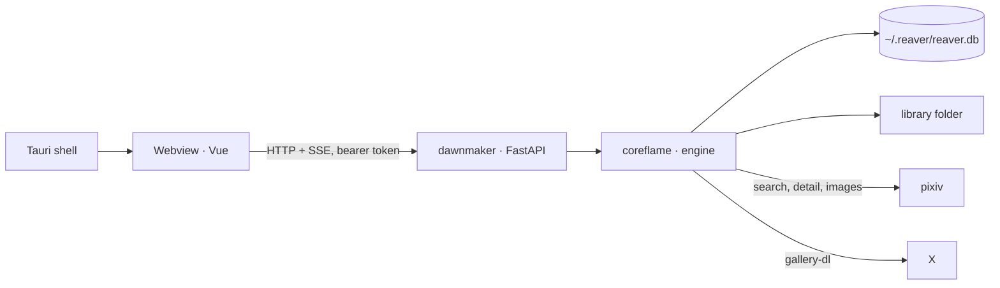

# Curio

Curio is a private desktop archive of illustrations of specific characters.
You name a character by its pixiv tag; Curio finds every artwork carrying that
tag, follows the artists it finds over to X, downloads the images once, dedupes
them across both sites, and keeps the result in a folder on your own machine.

Every record keeps its attribution permalink and the artist's name. Nothing is
redistributed, nothing is uploaded anywhere, and the crawler is deliberately
slow. It is an archive for one person, not a mirror.

The repository is called `flame-chaser`; the app is Curio. Inside, the Python
engine is `coreflame`, the local daemon is `dawnmaker`, and the desktop shell is
`deliverer`.

_Screenshots: TODO - add `docs/screenshots/{gallery,crawl,pipeline}.png` after the first release._

## Install

Installers are attached to each GitHub Release. Links below carry
`luissebastian953` until the first release is cut.

- **macOS** - download the `.dmg` for your Mac (`aarch64` for Apple Silicon,
  `x86_64` for Intel) and drag Curio to Applications. Until the app is
  notarised, macOS will refuse the first launch: right-click the app → **Open**
  once, after which it opens normally.
- **Windows** - run the NSIS `-setup.exe`. It installs for the current user;
  no administrator prompt.
- **Linux** - either the one-liner, which drops the AppImage in
  `~/.local/bin/curio` and adds a menu entry:

  ```sh
  curl -fsSL https://github.com/luissebastian953/flame-chaser/releases/latest/download/install-linux.sh | sh
  ```

  or the `.deb` / `.AppImage` from the release page. x86_64 only for now.

After that the app updates itself (see [Updates](#updates)).

## First run

Curio browses pixiv and X *as you*, the same way your browser does, so the
first launch shows a sign-in gate.

- **pixiv is required.** pixiv's tag search refuses anonymous requests, so
  without a session Curio cannot find anything.
- **X is optional.** It adds the artists' own posts once pixiv has found them.
- **Browse offline** dismisses the gate for this install; Settings › Accounts
  is the permanent place to sign in, sign out, or re-check a session.

Curio never sees your password. **Sign in** opens the site's own login page in
a separate window; when the site has set its session cookie, the window closes
and only that cookie is handed to the local daemon, which checks it with one
search request before storing it (owner-readable only, in `~/.reaver/secrets.json`).
An expired session shows as **expired** in the rail; sign in again from Settings.

## Using it

**Crawl → Add character.** Enter a display name and one or more pixiv tags.
Each tag is checked live (`✓ 8,412 artworks`, or a warning when the tag is
empty or uses fullwidth `（）`, which pixiv's exact search will not match). A
preview strip shows the newest results so you can confirm it is the right
character, and **Suggested tags** ranks tags that co-occur in those results.
Set **Minimum bookmarks** to skip low-engagement works (skipped works remember
the threshold that skipped them, so lowering it later re-opens them), optionally
add **X search & match terms** (each term is searched on X, images only, and
also filters the timelines of artists pixiv linked), tick which of **pixiv** /
**X** this character is crawled from, then **Save & run now**.

**Pipeline** shows one card per worker - one for pixiv, one for X, so each
site sees a single stream of requests - with its stage, posts this run and
requests per minute; **Open** shows that worker's stages, counters and log.
Below: the queue (drag to reorder, **Run now**) and today's finished jobs;
beside: the rate budget, the session's totals and the activity feed. Pause
the queue or one worker; cancel a job or everything. Cancellation is
cooperative and lands between records, never mid-write.

**Gallery** lists characters with cover and counts; a character page is an
infinite grid with a detail aside (source, artist, bookmarks, the same image on
the other site if dedupe linked them, and an "open on pixiv / X" link) plus the
observed-tags strip, where you can watch or ignore tags the crawl has seen.

**Settings** has Accounts (sessions), Language (interface language or follow
the system, translation coverage, and number/date/time/file-size formats),
Updates (check, download, install, the changelog), Theme (background colour
presets, plate opacity and blur, grid, scanlines, cut corners), Storage
(library and database paths),
Network (DNS resolver, proxy, pixiv request rate), Duplicates (dHash distance)
and About.

The **Shutdown app** button in the rail stops the crawler and the app together.
With a crawl running it asks you to click again; the job is marked
`interrupted` at the next start and the next run re-walks from the last watermark.

## How it works

The desktop app is a small Tauri shell around a Vue webview. On launch the
shell starts `dawnmaker`, a Python daemon bound to a random loopback port with
a per-launch token, and the webview talks to it over HTTP and server-sent
events. The daemon runs `coreflame`: pixiv search pages give artwork ids, a
visited-set is consulted before any request is spent, details are fetched and
normalised, artist profiles yield X handles, `gallery-dl` searches each X term
and reads those artists' timelines, and every image is hashed, deduped, stored
content-addressed and thumbnailed at ingest. Each character chooses its sources
(pixiv, X, or both); a source that is unticked is never requested.



Every flow in detail, with diagrams: [docs/flows.md](docs/flows.md). Design
rationale and the API contract: [docs/design/architecture.md](docs/design/architecture.md).
The engineering summary (requirements, data model, concurrency, security,
failure modes, trade-offs): [docs/design/system-design.md](docs/design/system-design.md);
UML views (use case, state, class, object, activity, sequence, component,
deployment and versioning): [docs/uml/](docs/uml/README.md).

## Where your data lives

- **Library folder** (Settings › Storage): `blobs/` holds every image once,
  named by its sha256; `thumbs/` holds 400 px WebP thumbnails made at ingest;
  `by-character/<slug>/` is the human-browsable view, built from hardlinks so it
  costs no extra space.
- **`~/.reaver/`** holds the SQLite database (`reaver.db`), `config.json`,
  `secrets.json` (session cookies, mode 0600), `twitter-cookies.txt` for
  gallery-dl, and the daemon lockfile. The database is never inside the
  library folder: SQLite on a synced or network drive is how databases get
  corrupted. Only image files move when you relocate the library.
- **Sync folders.** Curio refuses a library path under Dropbox, OneDrive,
  Google Drive or iCloud: sync clients materialise hardlinks as copies and
  silently double the archive.

## Updates

The app checks for a new release once a day and whenever you press **Check
now**. A new version shows as a banner in the rail; downloading is free and
touches nothing. Installing restarts the crawler, so it **never installs over
a running crawl** - with a job running the banner reads "installs when the
current crawl finishes" and waits. If, after an update, the app's version and
the crawler's version disagree, Settings › Updates says so: reinstall from the
release page.

## Blocked connections

Some ISPs interfere with pixiv (DNS hijack, SNI filtering, or outright TLS
interception). Settings › Network offers two layers: a **DNS-over-HTTPS
resolver**, which sidesteps DNS hijacking, and a **proxy** (`socks5://…` or
`http://…`), which also covers SNI/DPI blocks and is passed to gallery-dl.
Certificate verification is never disabled; a "proxy" that needs it is an
interceptor. From a terminal, `coreflame net www.pixiv.net` reports which layer
is blocking you.

## Development quick start

```sh
pnpm install                                   # root: workspace + git hooks
python -m venv reaver/.venv && . reaver/.venv/bin/activate
pip install -e "reaver[daemon,dev]"
cd deliverer && pnpm tauri dev                 # desktop app, daemon from the venv
```

Everything else - browser mode with or without Docker, local installers, CI
releases, checks, troubleshooting - is in [docs/build.md](docs/build.md).

## Repo layout

```
flame-chaser/
├── reaver/            Python: coreflame (engine) + dawnmaker (FastAPI daemon); check.sh; tests/
├── deliverer/         Tauri v2 shell (src-tauri/) + Vue 3 webview (src/); scripts/build-sidecar.sh
├── docker/            Dockerfile + entrypoint for the browser-mode stack
├── scripts/           bump-version.sh · check-version.sh · install-linux.sh
├── docs/              build.md · flows.md · design/architecture.md · design/system-design.md · uml/
├── .claude/skills/    add-source-adapter · commit · conventions-python · cut-release · diagnose-network
├── .github/workflows/ release.yml
└── CHANGELOG.md       user-facing; Settings › Updates renders it
```

## Contributing

- One repo, one pnpm workspace: `pnpm install` at the root, never `npm install`.
- Commit with `pnpm commit` (Conventional Commits, walked through by cz-git).
  Hooks run lint-staged on commit and commitlint on the message; scopes are
  fixed (`deliverer reaver coreflame dawnmaker design docker ci release docs
  skills deps`).
- `pnpm check` at the root is the definition of done: the webview checks
  (`vue-tsc`, ESLint, Prettier, i18n keys, Vitest), `reaver/check.sh` (ruff,
  mypy, offline tests, the `verify=False` guard) and the version gate.
- Add a line under `## Unreleased` in `CHANGELOG.md` for anything a user would
  notice. Tests never touch the network.

## Licence and terms of use

Curio is for private use. pixiv's ajax endpoints are not a public API and
automated access to X is against its terms; this project archives publicly
posted work for one person, keeps attribution on every record, does not
redistribute or monetise anything, never re-fetches works that are deleted
or made private at the source, and keeps request rates conservative. Respect both
sites' terms and the artists whose work you are collecting.
