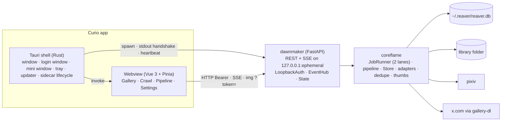
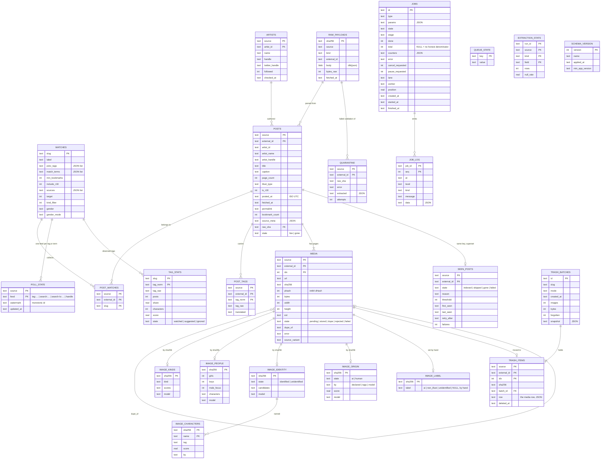

# Curio - System Design

The engineering view of Curio: requirements, constraints, the shape of the
system, its data, its concurrency, its security, how it fails and how it
ships. [`architecture.md`](architecture.md) is the long-form design record
with the reasoning behind each choice and the API contract (§6);
[`../flows.md`](../flows.md) draws every runtime flow; [`../uml/`](../uml/)
holds the UML views. This document is the one-sitting read that ties them
together, and it points into them rather than repeating them.

Vocabulary: **deliverer** is the Tauri shell + Vue webview, **dawnmaker** the
FastAPI daemon, **coreflame** the engine both the daemon and the CLI drive.
**LB** marks a load-bearing decision (root `CLAUDE.md`): changing it is a
design change.

---

## 1. Problem and goals

One person wants every illustration of a handful of characters, kept on their
own disk, browsable with the app closed, with attribution intact, and without
getting their accounts banned. The sources are pixiv (has character tags, has
a session-gated ajax API that is not public) and X (has no character
metadata, no free API since February 2026, and polices automation).

**Goals**

- Find artworks by character, not by artist: a character is a first-class tag
  on pixiv; X is reached *through* the artists pixiv surfaces (**LB**).
- Download each picture once across both sites; the pixiv PNG and the X JPEG
  of the same drawing are one image (**LB**: two-level dedupe).
- Keep the library a plain folder (hardlinks, content-addressed blobs) and the
  database elsewhere (**LB**).
- Be polite: one request stream per site, token buckets, retry only 429/5xx,
  never re-fetch what was seen (**LB**: the visited set).
- Be honest in the UI: real progress denominators or none, every job's fate
  recorded, every request counted.
- Survive the real world: sleep, lost Wi-Fi, a kill -9, an ISP that
  intercepts TLS, a synced folder, an update mid-crawl.

**Non-goals**

- Multi-user, remote access, redistribution, monetisation. The daemon binds
  loopback and the archive is one person's.
- Adopting an arbitrary existing folder as the storage model (metadata is not
  recoverable from a bare JPEG; it is an *import*, architecture §3.2).
- Hand-rolling X's protocol; `gallery-dl` owns that layer.
- Animated works (ugoira, video): recorded as skipped.

## 2. Requirements

### Functional

| Area | Requirement | Where |
|---|---|---|
| Characters | add/edit with pixiv tags, X match terms, per-source toggle, posts per run (1..1000), bookmark floor, R-18, kind filter, gender filter | `Watch`, `WatchForm.vue`, `/api/watches` |
| Validation | live tag probe: counts, 12-image preview, name suggestions from Danbooru and Wikidata | `dawnmaker/probe.py`, `coreflame/names.py` |
| Crawl | per character: pixiv discover → tags → link → download; X search to target + followed timelines | `handlers.plan`, `pipeline.py` |
| Queue | one worker per source, pause (queue and job), reorder, run now, cancel, retry; survives restart | `jobs.py` |
| Live view | stages, progress, items, log, requests per minute, per worker; mini window and tray when unfocused | SSE, `jobs` store, `background.ts`, `pip.rs` |
| Gallery | characters, cursor-paginated grid with source and label (AI / Non-Illust / Unidentified) filters, a label badge per tile settable by hand, post detail with pages, related and linked posts, fullscreen viewer | `/api/gallery/*`, `/api/posts/*`, `/api/images/*/label` |
| Curation | watch or ignore observed tags; delete by image, tag, Smart criteria or all, to a 30-day trash with Undo; crawl-time cleanup rule | `tags.py`, `trash.py` |
| Accounts | sign in via the site's own page, verify before storing, show expiry | `auth.rs`, `dawnmaker/auth.py` |
| Storage | pick the library folder (refuse sync roots), usage figures, export/import the archive as one file | `library.py`, `bundle.py` |
| Updates | signed updates from GitHub Releases, installed only when idle, changelog in-app | `updater.ts`, `release.yml` |
| Network | DoH resolver, proxy, a diagnostic that names the blocking layer, a speed and latency signal | `net.py`, `speed.py` |
| CLI | the same engine from a terminal: watch, poll, jobs, bundle, net, doctor | `cli.py` |

### Non-functional

| Quality | Target | Mechanism |
|---|---|---|
| Politeness | ≤ `pixiv_rate` req/s to pixiv (default 1), one stream per host, no retry on 4xx other than 429 | `TokenBucket` global + per endpoint, `SourceClient` retry policy, one worker thread per lane |
| Idempotence | re-running any job is safe | every write is an upsert on a natural key; the visited gate; watermarks advance only after a full walk |
| Durability | no corrupt db, no half-written image | SQLite WAL in `~/.reaver`; blobs written then rows updated; content addressing; pre-migration backup |
| Responsiveness | a 500-card grid scrolls | 400 px WebP thumbnails at ingest, immutable caching, keyset cursors |
| Resilience | sleep, offline, crash, kill -9 are not failures | heartbeat grace, `Offline` → hold and requeue, `interrupted` at boot, lockfile reclaim |
| Security | nothing on the machine but Curio can drive the daemon; secrets never in world-readable places; TLS always verified | ephemeral port, per-launch token over stdout, Host/Origin checks, 0600 files, no `verify=False` anywhere (**LB**) |
| Portability | macOS (arm64, x86_64), Windows, Linux (x86_64), plus a Docker browser mode | Tauri v2; PyInstaller onedir; system webview |
| Offline tests | every test runs without network | fixture payloads, generated images, fake adapters |

## 3. Constraints

- **pixiv's ajax endpoints are not a public API.** Shapes drift silently;
  every raw payload is retained (zlib, content-addressed) and per-field null
  rates are recorded per run so drift is a *re-parse*, not a re-fetch, and a
  shape change raises a DRIFT note.
- **X has no API and no character metadata.** Discovery there is impossible;
  search exists only through gallery-dl, is target-driven per character, and
  is the first thing X polices (**LB**).
- **`i.pximg.net` 403s without `Referer`** (**LB**).
- **An ISP has been observed intercepting TLS** with a spoofed certificate.
  Verification failure is evidence of a MITM, so disabling verification must
  not exist as an option (**LB**). DoH and a proxy are the sanctioned
  workarounds (architecture §4c).
- **Python ≥ 3.10** (`timezone.utc`, no `StrEnum`); the engine must import
  without the daemon's or the classifier's dependencies.
- **Snowflake ids exceed JS safe integers**: ids are `str` everywhere.
- **SQLite on a synced or network folder corrupts**: the db lives in
  `~/.reaver`, only blobs live in the library (**LB**).
- **The webview must not touch the filesystem** (**LB**): images come over
  loopback HTTP, which is also what makes a future LAN view free.
- **Legal posture**: private archive of publicly posted work, attribution
  permalink on every post, conservative rates, deleted or privated works
  removed. Keep it that way.

## 4. Architecture overview

Three processes on one machine. The shell owns the window and the daemon's
lifetime; the webview owns pixels and never the disk; the daemon owns the
database, the library and every outbound request.



Component boundaries and interfaces: [`../uml/07-component-diagram.md`](../uml/07-component-diagram.md).
Why Tauri + a Python sidecar rather than a rewrite or Electron: architecture §1 and §2.

The dependency rule: `dawnmaker` imports `coreflame`; `coreflame` never
imports `dawnmaker`; `deliverer` knows neither beyond the HTTP contract.
`handlers.py` is the only place the runner learns what a "poll" is, so the
pipeline functions stay callable from the CLI without a runner.

## 5. Data design

### 5.1 Logical model

SQLite, 22 tables, no foreign keys by design (natural keys everywhere, so
every write is an idempotent `INSERT ... ON CONFLICT DO UPDATE` and a crash
between two writes leaves nothing to reconcile). The relationships below are
logical.



Design notes:

- **Posts vs images.** A pixiv artwork with 12 pages is one `posts` row and
  12 `media` rows; the gallery counts images, the visited set counts posts.
- **`seen_posts` is a superset of `posts`** and is the gate (**LB**). Its four
  states are four retry policies; `threshold` stores the config value that
  caused a skip so loosening the rule reopens exactly those rows.
- **Two forms of every tag.** `tag_raw` is what pixiv matches on;
  `tag_norm` (NFKC + casefold) groups `申鶴（原神）` with `申鶴(原神)`.
- **Classifier tables key on the blob's sha**, not the post: a repost shares
  the label, and a model change is a re-label.
- **Derived and rebuildable**: `tag_stats` (except its `state`, which carries
  user intent), `by-character/`, thumbnails. Deleting them loses nothing.
- **Not exported**: `jobs`, `job_log`, `queue_state`, `trash_*`. Runtime
  state is the machine's, not the archive's.
- **Pagination** is keyset on `(posted_at DESC, external_id DESC)` with an
  opaque base64url cursor (a raw `+00:00` in a query string decodes to a
  space; that bug was real).

### 5.2 Physical layout

```
~/.reaver/  (REAVER_HOME)                 <library folder>/  (Settings › Storage)
├── reaver.db (+ -wal, -shm)              ├── blobs/aa/bb/<sha256>.<ext>   content-addressed originals
├── reaver.db.pre-vX.Y.Z.bak              ├── thumbs/aa/bb/<sha256>.webp   400 px, made at ingest
├── config.json                           ├── by-character/<slug>/<artist>_<id>_p<n>.<ext>   hardlinks
├── secrets.json          0600            └── trash/<sha256>.<ext>         30 days, Undo
├── twitter-cookies.txt   0600
├── dawnmaker.lock        {pid, port, started_at}
├── models/<repo>/<rev>/  classifier weights
├── exports/              default bundle destination
└── import/<stamp>/       staging for an import
```

Hardlinks rather than symlinks because symlinks break on copy, do not survive
a zip and need elevation on Windows; `detect_link_mode` records `hard |
symlink | copy` once per library so exFAT is a decision, not a traceback.
Sync roots (Dropbox, iCloud, OneDrive, ...) are refused at folder-pick time
because sync clients materialise hardlinks as copies.

### 5.3 Capacity

Sizing for the realistic archive: tens of characters, tens of thousands of
posts, ~100k images, ~100 GB of blobs.

| Concern | Cost | Why it stays flat |
|---|---|---|
| Visited check | one indexed PK lookup per listed id | consulted from the listing, before any detail request |
| Dedupe | sha lookup + Hamming over one artist's hashes | scoped to one artist, O(hundreds) not O(archive) (**LB**) |
| Grid page | ~15 KB per card | thumbnails at ingest; full-size PNGs never cross the webview |
| SSE | 500-event ring buffer, bounded per-client queue (1000) | a stalled client drops events, never blocks the producer |
| Raw retention | zlib'd JSON per fetched detail (a few KB each) | makes re-normalisation free; `raw_payloads` is the biggest table and still small beside the blobs |
| Classifier | ~30 ms per image on CPU for kind and again for AI-or-hand; WD and Camie models ~470 MB + ~790 MB downloaded once, the AI detector 17 MB | only on bytes that passed dedupe and the filters |

## 6. Core mechanisms

Each of these is a decision with a reason; the diagrams in
[`../uml/02-state-machine.md`](../uml/02-state-machine.md) and
[`../uml/05-activity-diagram.md`](../uml/05-activity-diagram.md) show the
states and steps.

1. **Discover on pixiv, follow on X** (**LB**). The listing page gives ids
   for free; the watermark (monotonic id, walk one full page past the floor,
   advance only after the tag is fully walked) and the visited gate are
   checked there. The detail request is spent only on an unseen id. Artists
   found on pixiv give X handles through their pixiv profile; X supplies
   those handles' timelines, filtered by match terms.
2. **X search to a target.** Per character, N new *kept* posts per run:
   walk each term newest-first from its `search:` cursor, then further back
   from its `search-lo:` cursor; stop at N kept, at 10×N listed, or when
   history ends. `twitter_search_limit = 0` turns search off.
3. **Three-layer normalisation.** `put_raw` (retain) → `specs.extract` (glom,
   never raises, nulls on missing) → `IllustRecord` (pydantic coerces and
   validates) → `upsert_post`, or `ValidationError` → quarantine with the raw
   hash. Semantic reconciliation across sources is deliberately not done
   (`bookmark_count` ≠ `favorite_count`).
4. **Two-level dedupe** (**LB**). sha256 for exact; dHash with Hamming ≤ 6
   (configurable) within one artist for the PNG-vs-JPEG repost.
5. **Image kinds, people, identity, origin** (optional `classify` extra). Keep
   only illustration and screencap; a per-character gender rule; two taggers
   vouch for a character name; AI-made or by hand from pixiv's flag, an AI
   hashtag, or a detector. Verdicts are rows on the sha; a rejected image
   keeps its url and is reopened when a rule loosens. One badge per image
   is folded from them in SQL (`label.py`: non-illust, then AI, then
   unidentified), and a label set by hand sits on top of the fold.
6. **The job queue.** Rows, not objects: `jobs` is the queue, the history and
   the cross-process control plane (`cancel_requested`, `pause_requested`).
   One `plan` per request makes per-source jobs so the lanes stay
   independent.
7. **Trash with Undo.** A deletion is a batch; the media row rides as JSON;
   blobs are *renamed* into `trash/` (same filesystem); "forget" marks the
   post `skipped/deleted` in the visited set so no run brings it back.
8. **Bundles.** A consistent db snapshot (backup API, never a file copy) plus
   settings, UI state, blobs and thumbs in `.zip` or the stdlib-only framed
   `.curio` whose per-chunk CRCs and per-entry hashes make damage locatable
   and recoverable by scanning. Import verifies, stages, migrates the staged
   copy, merges in one transaction, moves bytes last.

## 7. Concurrency model

| Where | Model | Rule |
|---|---|---|
| Engine workers | one OS thread per lane (`pixiv`, `twitter`), each with its own `Store` connection | never two workers on one source (**LB**); an `any` job (no remote request) goes to whichever is free, claimed with a conditional `UPDATE` |
| Cancel / pause | cooperative | `ctx.check()` between records and at every stage, never inside a write; a cancel can only land between complete records |
| Daemon requests | FastAPI sync endpoints on the threadpool | one `Store` per request (`State.open_store`), because the dependency and the endpoint run on different threads and the SSE generator pins one for its lifetime |
| Event fan-out | `EventHub`: producer appends to a ring under a lock, each subscriber has a bounded queue | `put_nowait`, drop on full; `close()` ends every stream so uvicorn can exit |
| Online watch | one monitor thread, probes every 10 s while a worker is busy and every 5 s while offline | a transport failure asks `WATCH.failed()` once per second at most; `Offline` is re-raised, never retried with backoff |
| Heartbeat | a native thread in the shell every 5 s; a watchdog thread in the daemon every 2 s | not a webview timer: WebKit and App Nap throttle hidden windows past the timeout |
| Shell ↔ webview | Tauri IPC; the mini window gets a `PipTick` at most twice a second | the mini window never fetches; the main window acts on its `pip:*` events |
| CLI vs daemon | share the db and the `jobs` table | the lockfile prevents two daemons; a CLI `poll` while the daemon runs is the user's choice, protected by WAL and upserts |
| Rate limiting | per-source global `TokenBucket` plus per-endpoint buckets, process-wide `METER` tagged with the sending thread's job | a burst of image downloads cannot starve the metadata endpoint |

## 8. Interfaces

The full contract is architecture §6. The shape of each surface:

| Surface | Transport | Auth | Notes |
|---|---|---|---|
| `GET/POST/PUT/PATCH/DELETE /api/*` | HTTP/1.1 on `127.0.0.1:<ephemeral>` | `Authorization: Bearer <per-launch token>`; `Host` and `Origin` checked; CORS reflects an allowed origin only | errors `{"error": {code, message}}`; `202` for anything that becomes a job; `409` for state conflicts (`busy`, `not_running`, `not_queued`) |
| `GET /api/events` | SSE | `?token=` (EventSource cannot set headers) | event types `job.queued/started/stage/progress/item/log/finished`, `pipeline.paused`, `library.media`; `Last-Event-ID` replay from a 500-event ring; keepalive every 15 s; `live=false` for one-shot catch-up |
| `GET /api/media/{sha}/thumb|full`, `GET /api/preview/{id}/thumb` | HTTP, `` | `?token=` | thumbs immutable-cached; full supports Range; preview only for probed ids |
| `DAWNMAKER_READY {port, token, pid}` | one line on the daemon's stdout | the pipe is private to the parent | a stray `print()` in the daemon breaks the spawn; everything else logs to stderr |
| Tauri commands | IPC `invoke` | capabilities per window label; `source-login` has none | `daemon_endpoint`, `source_login`, `shutdown_app`, `pip_*`, `tray_update`, `show_main` |
| Window events | IPC `emit` | | `pipeline:tick` to the mini window; `pip:*` and `tray:*` back |
| `coreflame <cmd>` | argv | the user's shell | same engine, same db; `coreflame jobs cancel <id>` is honoured by a running daemon |
| gallery-dl | subprocess, JSON on stdout | cookies file 0600, proxy via env/args | run as our own interpreter (`python -m gallery_dl`, or the frozen exe `--gallery-dl`) |

Shape discipline: `dawnmaker/app.py` defines a body with a pydantic `*In`
model; `deliverer/src/lib/types.ts` mirrors every response by hand. A field
renamed on one side and not the other is a runtime `undefined`, which is why
the `feature-workflow` skill lists the two as one step.

## 9. Security model

Threats considered: another process or a malicious web page on the same
machine driving the daemon (DNS rebinding); secrets leaking through files,
argv or the webview; an on-path attacker on the network; a stolen or lost
update signing key; remote content inside the app's windows.

| Threat | Control | Where |
|---|---|---|
| Any local process calls the API | ephemeral port + per-launch bearer token that only ever exists in the daemon's memory, the parent's pipe and the webview's memory | `__main__.py`, `sidecar.rs`, `endpoint` store |
| DNS rebinding from a browser tab | `Host` must be `127.0.0.1:<port>` or `localhost:<port>` (421); `Origin` must be a Tauri origin, or `localhost` only with `--dev` (403); CORS never `*` | `security.py` |
| Token in a URL leaking via logs or referrers | `?token=` accepted on exactly `/api/events`, `/api/media/*`, `/api/preview/*`; ignored elsewhere; constant-time compare | `security.py` |
| Session cookies at rest | `secrets.json` and `twitter-cookies.txt` are 0600, written only by `save_secrets` / `auth.py`; `config.json` and `/api/config` never contain them; env can override so nothing is on disk at all | `config.py`, `auth.py` |
| Password exposure | Curio never sees one: the site's own login page opens in a window without IPC capabilities; only the needed cookies are harvested and sent to the daemon; the window closes | `auth.rs`, `lib.rs` (only the `main` window's death stops the daemon) |
| TLS interception | certificate verification is always on; `verify=False` is grepped for in `check.sh` and refused by a test; DoH and a proxy are the workarounds (**LB**) | `http.py`, `net.py`, `check.sh` |
| A hostile update | minisign signature checked against the pubkey compiled into the app; the private key lives only in CI secrets; losing it strands every install | `tauri.conf.json`, `release.yml` |
| Remote content with IPC | the `source-login` window is absent from the capabilities file; the mini window's capability grants events and drag only | `capabilities/` |
| Webview reaching the disk | no `fs` plugin scope, no `asset:` protocol, CSP `connect-src`/`img-src` limited to `127.0.0.1:*` | `tauri.conf.json` |
| A second daemon on the same db | lockfile with pid + port liveness check; orphan reclaimed only if its parent is gone | `__main__._lock`, `sidecar.rs spawn` |
| Image proxy abuse | `/api/preview` serves only ids a probe returned, cached 15 min, 256 max | `probe.py` |

Not defended: a process running as the same user that reads the daemon's
memory or the webview's. That is the OS's boundary, not Curio's.

## 10. Reliability and failure modes

The consolidated table; the per-area tables with symptoms and root causes are
architecture §4b.4, §4c.7, §8 and §8b.6.

| Failure | Detected by | Response | Recovery |
|---|---|---|---|
| Shell dies (kill -9, panic) | daemon hears no heartbeat for 30 s | one 15 s grace, then `should_exit`, `hub.close()`, exit within 3 s | next launch finds a stale or orphaned lock, reclaims it |
| Laptop sleeps mid-crawl | same silence | the grace absorbs it; a live shell beats again on waking | nothing to do |
| Daemon dies mid-job | `running` rows at next boot | marked `interrupted` (or requeued at the front if the queue was held) | `retry` makes a fresh copy; the visited gate makes it a resume |
| Internet gone | transport error + probe says unreachable | `Offline`: job to the front, queue held with reason `offline`, UI says so | the watch lifts the hold when a probe succeeds |
| pixiv 429 / 5xx | status code | retry with backoff, within the bucket | `failed` in `seen_posts` with `retry_after` if it keeps failing |
| pixiv 404 / 410 | status code | `gone`, never revisited; post marked `gone` | none needed |
| Site shape changed | `ValidationError`, or a null-rate jump in `extraction_stats` | quarantine with raw hash; DRIFT note in the job log | fix the spec, re-parse `raws_for`; never re-fetch |
| Session expired | 401/403 on the one-search check | badge "Session expired"; `poll_pixiv` refuses to start | sign in again |
| Worker thread error outside a job (lost db, disk I/O) | exception around `_take` | logged, job marked failed, connection reopened, backoff 2 s → 30 s; the thread never dies | automatic |
| Library on exFAT | `detect_link_mode` | `copy` or `symlink` recorded, not a traceback | none needed |
| Library under a sync root | path markers at `PUT /api/config` | refused with a message | pick another folder |
| Update while crawling | `/api/health idle = false` | updater waits, polls every 5 s | installs when idle |
| Downgrade onto a newer db | `min_app_version` in `schema_version` | the daemon refuses to open it | run the newer version |
| Migration fails | exception in `apply` | that step's transaction rolls back; `reaver.db.pre-vX.Y.Z.bak` exists | restore the backup |
| Bundle damaged | per-chunk CRC, per-entry sha, trailer hash | names the entries; `salvage` imports the intact ones; a hurt image goes back to `pending` | next crawl re-fetches |
| Second Curio launched | lock held by a live pid whose port answers | `already_running`, exit 3; shell fails the launch with a message (orphan: SIGTERM and retry ≤ 20 s) | close the other one |
| Hidden window throttled | (prevented) | the heartbeat is a native thread, not a webview timer | none needed |

## 11. Observability

Everything the user can see is derived from four records, all local:

- `job_log` rows per job (`stage`, `item`, `progress`, `log`), streamed live
  as SSE and shown as the last 200 lines on `GET /api/jobs/{id}`.
- `jobs.counters` as live tallies during a run and final counts after
  (`listed`, `gated`, `fetched`, `new`, `stored`, `dupes`, `failed`, ...).
- `METER`: requests actually sent in the last minute, per budget and per
  job, read by `GET /api/pipeline` for the Rate budget panel and each
  worker's req/min.
- `extraction_stats`: per-field null rates per run, the only signal for a
  silent site change.

Plus the daemon's stderr log (`-v` for debug), the engine's own uptime line
at the start of every job ("engine up 2.1h ... restart the daemon to pick up
edited code"), `coreflame doctor`, and `coreflame net <host>` for the
network layer.

## 12. Deployment and versioning

Drawn in [`../uml/08-deployment-diagram.md`](../uml/08-deployment-diagram.md).
In one paragraph: `tauri.conf.json` holds the version; `bump-version.sh`
copies it into `package.json`, `pyproject.toml` and `coreflame/__init__.py`
and promotes the changelog; `check-version.sh` fails `pnpm check` and CI on
drift; a `vX.Y.Z` tag runs `release.yml`, which checks, then on four runners
builds the PyInstaller sidecar *before* `tauri-action`, smoke-tests it, builds
and signs the bundle, and drafts a GitHub Release with `latest.json`. The
installed app checks daily, verifies the signature against its compiled-in
key, and installs only when the queue is idle. The database schema is an
integer with forward-only migrations, backed up before each, stamped with the
app version that applied it so an older daemon refuses it.

## 13. Trade-offs and rejected alternatives

| Decision | Chosen | Rejected | Reason |
|---|---|---|---|
| Shell | Tauri v2 + Python sidecar | Electron; rewriting the engine in Rust/JS; Nuxt | the engine exists and works; Tauri gives tray, updater, dialogs without shipping Chromium; SSR has no meaning in a webview (§2, §2.8) |
| Sidecar packaging | PyInstaller `--onedir` under `bundle.resources` | `--onefile` + `externalBin` | instant cold start, AV-friendly layout, NSIS replaces resources on update but not externalBin (§2.4) |
| Images to the UI | loopback HTTP | `convertFileSrc` / asset protocol | one code path, auth in one place, LAN-ready (§1) |
| Daemon lifetime | heartbeat from a native thread + lockfile + kill on exit | parent-pid polling; a webview timer | `getppid` is meaningless on Windows, reparenting unobservable on macOS; hidden-window timers throttle (§2.1) |
| Push channel | SSE with a ring buffer | WebSocket | one-directional, EventSource reconnects and replays by itself, cancel is a normal POST |
| Workers | one thread per source | a pool; one thread for everything | the constraint is the remote rate limit; two hosts have two budgets (§4) |
| Human-browsable library | hardlinks | symlinks; a copy tree | copy-safe, zip-safe, no elevation; zero extra bytes (§3.1) |
| Dedupe scope | per artist | whole archive | O(hundreds) vs O(archive); cross-artist dHash collisions are not the phenomenon (§dedupe) |
| Visited set | four states with distinct retry policies | one `seen` flag | otherwise either re-fetch deleted works forever or blacklist a transient 500 (§4b.1) |
| X access | gallery-dl subprocess | hand-rolled GraphQL client; the paid API | protocol churn belongs to a maintained dependency; no free API exists |
| X search | target-driven, newest-first then backwards | small fixed cap | the owner's call (2026-09-29): N kept posts per run, resumable across runs |
| ISP interference | DoH + proxy + diagnostic | `verify=False` | a validation failure is evidence of a MITM; disabling hands over the session (§4c.4) |
| DB location | `~/.reaver` | inside the library | SQLite over sync/network folders corrupts (§3) |
| Existing folders | import with dHash adoption | a second storage mode | metadata is not recoverable from a bare file (§3.2) |
| Backup format | `.curio` framed stream and `.zip` | db file copy; tar | WAL makes a file copy inconsistent; `.curio` locates damage and survives truncation (§3.4) |
| Deletion | trash + Undo + "forget" | immediate unlink | a hardlinked blob frees nothing until every name goes; the visited set would re-fetch the post |
| Mini window | a second, bare Tauri window fed by events | a hidden-then-shown window; a token-holding second webview | closed releases memory; no token means no second attack surface (§10.21) |

## 14. Open items

From architecture.md's status note and the changelog, as of 2026-10-26:

- `/library/reindex | gc | import | verify` and `/artists*` routes are
  designed, not built. `LibraryView.orphans` and `coreflame import` exist at
  the engine level.
- The `.curio` file association (double-click to import) is deferred.
- The updater's public key and the GitHub owner are placeholders until the
  one-time setup in `cut-release` is done; `latest.json` 404s while a
  release is a draft.
- Only English and Japanese locales are complete; the i18n check enforces
  key parity for enabled locales.
- Linux is x86_64 only; Wayland cannot float the mini window and falls back
  to notifications.
