# Curio — how the pieces move

Twelve flows (thirteen diagrams — sign-in has two), each drawn from the code
as it is in the repo (file names are given so you can check). Read [README.md](../README.md) for what Curio is and
[docs/design/architecture.md](design/architecture.md) for why it is shaped
this way; this page is the *how*.

Vocabulary: **deliverer** is the Tauri shell + Vue webview, **dawnmaker** is
the FastAPI daemon, **coreflame** is the crawl engine the daemon and the CLI
both drive.

---

## a. System overview

Three processes on one machine. The shell owns the window and the daemon's
lifetime; the webview owns every pixel and never touches the filesystem; the
daemon owns the database, the library folder and every outbound request. pixiv
is reached with `httpx` through `coreflame.http.SourceClient` (token buckets,
retries, optional DoH resolver and proxy); X is reached only through the
`gallery-dl` binary, which gets the same proxy. Images come back to the grid as
`http://127.0.0.1:<port>/api/media/{sha}/thumb`, never as `file://`.

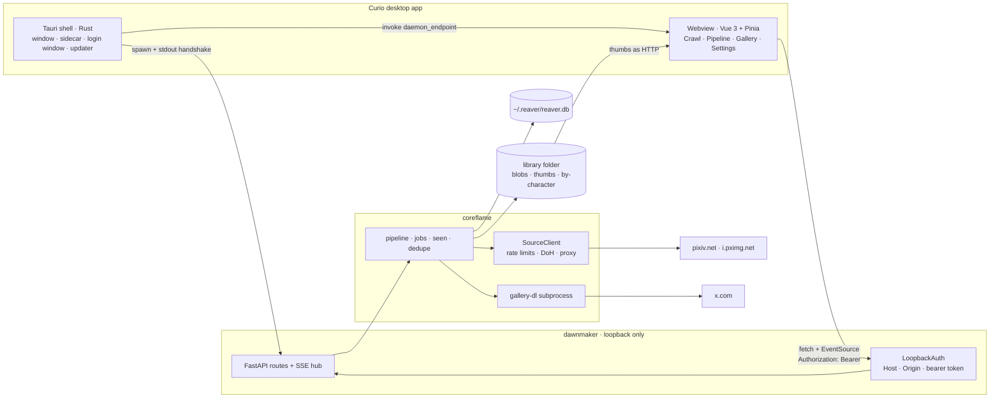

## b. Process lifecycle

`deliverer/src-tauri/src/sidecar.rs` spawns the daemon (in a debug build:
`python -m dawnmaker`, or `REAVER_DEV_CMD`; in a release build the PyInstaller
bundle under `resources/sidecar/`), reads exactly one line from its stdout and
keeps the child handle. `dawnmaker/__main__.py` binds `127.0.0.1:0`, takes the
lockfile, prints `DAWNMAKER_READY {"port","token","pid"}` and only then
serves. The token rides the stdout pipe because it is private to the parent —
argv shows in `ps`, a file is readable by anything.

Three layers end the daemon, because no single one covers every exit. Layer 1:
the shell kills the child on `WindowEvent::Destroyed`, `RunEvent::ExitRequested`
and `RunEvent::Exit` (Cmd-Q, the tray, the rail's **Shutdown app** command).
Layer 2: `lib/api.ts` posts `/api/heartbeat` every 5 s and the daemon's
watchdog exits after 30 s of silence — covering `kill -9` and Rust panics —
with a sleep guard: a gap over 300 s is a laptop wake, so it grants one more
timeout instead of dying. Layer 3: `~/.reaver/dawnmaker.lock` makes a second
launch attach rather than race the first over the same SQLite file; a lock
whose pid is dead or whose port does not answer is reclaimed.

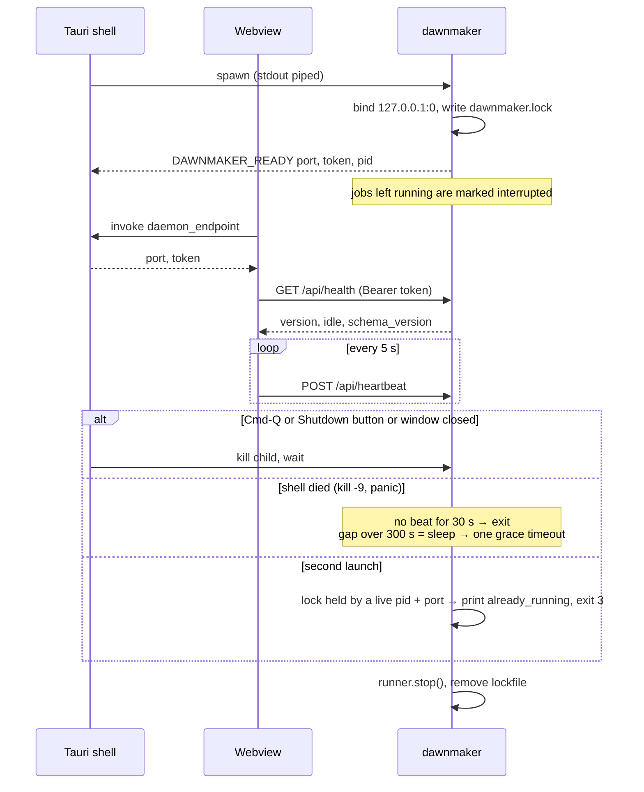

## c. Crawl pipeline

A crawl is planned into one `poll` job per source per character plus an X
`timelines` job (`coreflame/handlers.plan`); the pixiv job runs the four
stages below on the pixiv worker, the X job searches and downloads on the X
worker (`coreflame/handlers.py` → `pipeline.py`). The decisions that keep it cheap
are all in the discover stage of `sources/pixiv.py`: the listing page already
carries the id, so the watermark and the visited set (`seen.py`) are consulted
*before* a detail request is spent. `seen_posts` has four states and they are
four retry policies — `indexed` is never revisited, `skipped` only when the
config that rejected it changes (the `threshold` is stored with it), `gone`
(404/410) never, `failed` after `retry_after`. Watermarks are monotonic ids;
the poller walks one full page past the floor and advances the watermark only
after a tag is fully walked. Every detail payload is retained raw (zlib,
content-addressed) before extraction, so a spec fix is a re-parse, not a
re-fetch; a record that fails validation goes to quarantine with its raw hash.

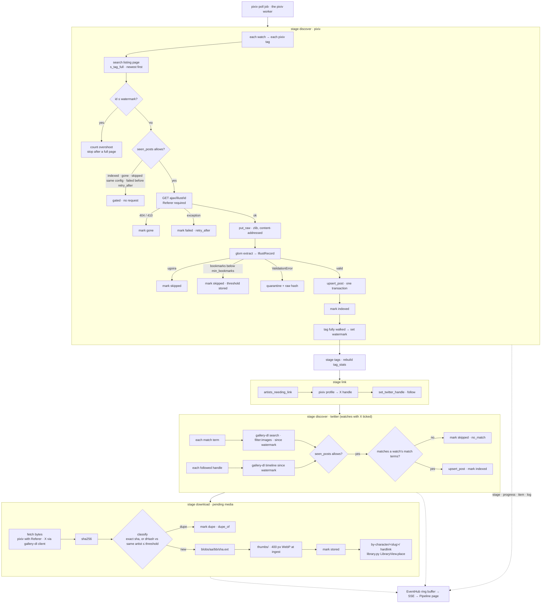

The dedupe threshold (default 6, Settings › Duplicates) and the dHash
comparison scoped to one artist are what keep near-duplicate detection
O(hundreds) per image instead of O(archive). Progress denominators are honest:
the pixiv discover stage sends `total: null` because unvisited work is only
known as the listing unfolds; link, twitter and download know their counts.

## d. Job model

`coreflame/jobs.py`. Jobs are rows in the `jobs` table with six states. One
worker thread per source lane (`pixiv`, `twitter`) takes the first `queued`
row of its lane (or an `any` job) by `position`, claiming it with a
conditional UPDATE; the constraint is the remote rate limit, so there is no
pool and never two workers on one source. A paused job (`pause_requested`)
holds at its next `check()`, keeping its lane. Cancellation is cooperative: the
`cancel_requested` column is read by `ctx.check()` between records and at every
`ctx.stage()`, never inside a write, so a cancel can only land between
complete records — and because it is a column, a cancel from another process
(the CLI) is honoured too. A job still `running` when the daemon starts was
killed mid-flight and is marked `interrupted`, not forgotten.

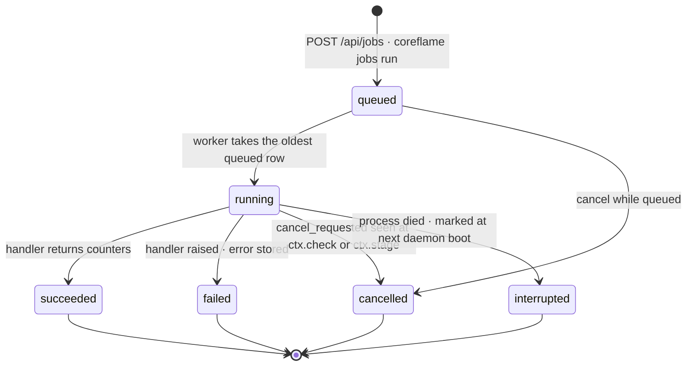

`GET /api/health` reports `idle` (no job queued or running); the updater and
the Shutdown button both read it.

## e. Sign-in

Curio never sees a password. On desktop `stores/sources.ts` invokes the Rust
command `source_login` (`src-tauri/src/auth.rs`), which opens the site's own
login page in a second window labelled `source-login` — deliberately absent
from the capabilities file, so remote content in it has no IPC — and polls
`cookies_for_url` every 500 ms for up to 300 s until the cookies the crawler
needs exist (`PHPSESSID` for pixiv; `auth_token` and `ct0` for X). The window
closes and the cookie goes straight to the daemon; it is never kept in the
webview or localStorage. `dawnmaker/auth.py` checks the shape, then verifies a
pixiv cookie with **one search request** (the request the crawl needs, so its
verdict is the one that matters) *before* writing `~/.reaver/secrets.json`
(0600). A rejected cookie leaves the previous one in place. X cookies cannot be
verified without a timeline fetch, so they are written as
`~/.reaver/twitter-cookies.txt` for gallery-dl and reported as "stored".

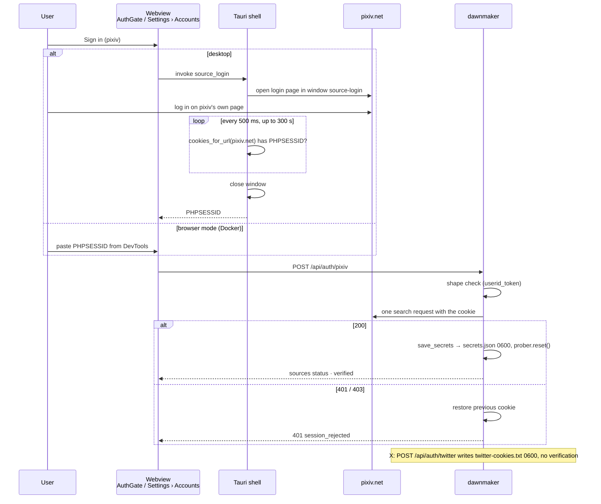

Expiry: when the daemon starts with a stored cookie, `Auth.__init__` runs the
same verification on a background thread; the rail badge shows "checking…"
until it lands and **Session expired** if it fails. **Check** in Settings
posts `/api/auth/pixiv/verify`; **Sign out** is `DELETE /api/auth/pixiv`.
`poll_pixiv` refuses to start unauthenticated instead of 401-ing once per tag.

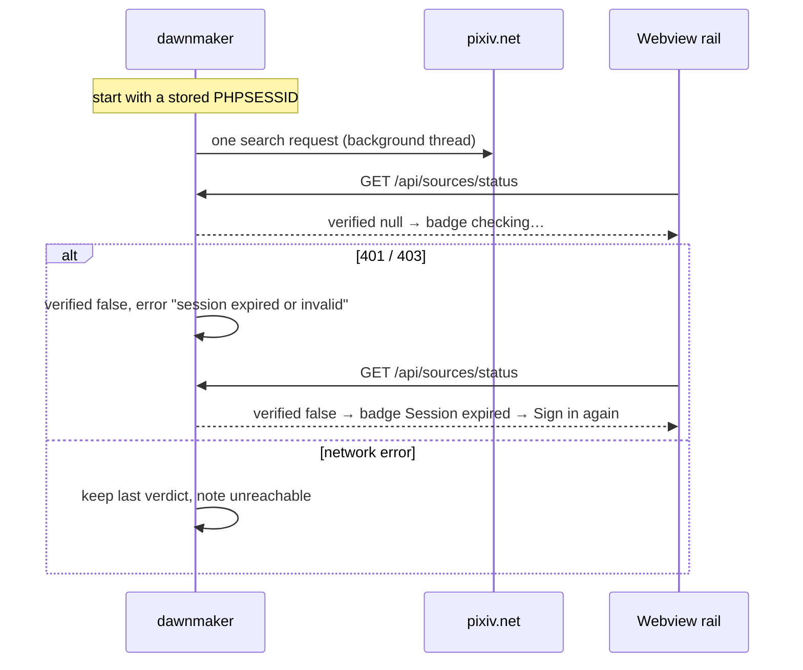

## f. Character form probe

`components/WatchForm.vue` validates every pixiv tag as you type. Each edit
waits 350 ms, then posts all tags (max 8) to `POST /api/pixiv/probe`.
`dawnmaker/probe.py` spends **one listing page per tag** — never a detail
fetch, nothing written to `seen_posts` or blobs — caches the verdict per
(tag, R-18 mode) for 10 min, and flags fullwidth `（）` locally without a
request because pixiv's exact-tag search will not match them. The response
carries per-tag counts, a 12-image preview (newest first across tags, deduped
by id), up to 12 suggested tags ranked by `tags.suggest_from_listing`
(frequent in these results, rare across other characters), and a backfill
estimate (`artworks / pixiv_rate`, an upper bound).

Preview thumbnails are on `i.pximg.net`, which 403s without a `Referer`, and
the webview's CSP only allows `127.0.0.1`, so `` loads
`/api/preview/{id}/thumb?token=` and the daemon proxies it — only for ids a
probe returned (anything else is 404 `not_probed`), cached 15 min, at most 256
in memory. It is not a general image proxy.

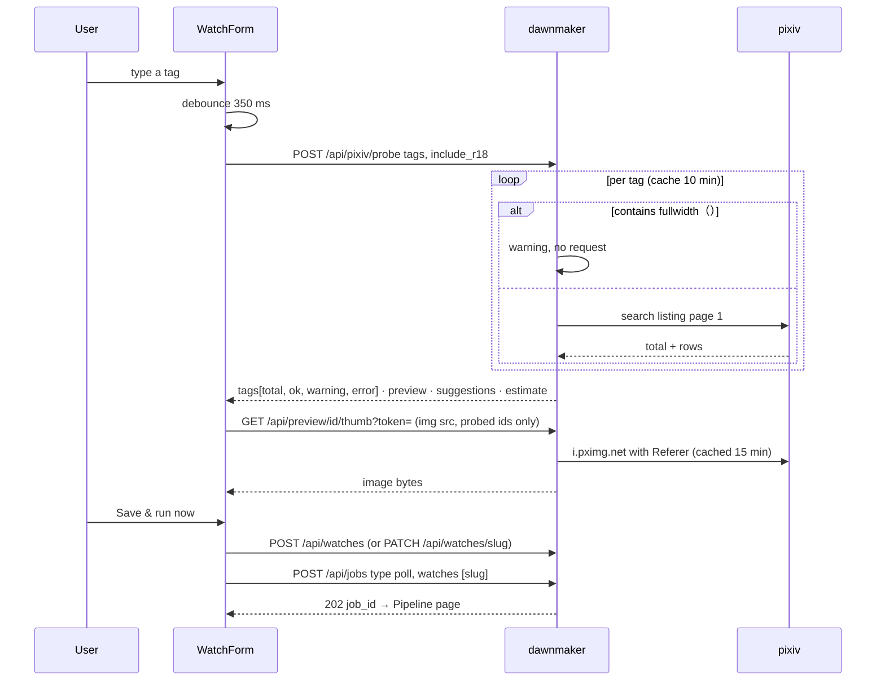

Signing in or out calls `prober.reset()`: the cached verdicts may have been
anonymous 401s.

## g. Updater

`stores/updater.ts` over `tauri-plugin-updater`. `schedule()` runs at boot:
check now if the last check is older than a day, then every 24 h; **Check
now** in Settings › Updates calls `check()` directly. Downloading is free and
touches nothing. `install()` first refreshes `/api/health`; if the queue is not
idle the phase becomes `waiting` and a 5 s poll retries until it is —
installing kills the sidecar and relaunches, and that must never land between
a blob write and its `media` row. "Install automatically" (`auto`) chains
download and install, still behind the same gate. Outside Tauri the store is
born `unsupported`. Settings › Updates renders `CHANGELOG.md` and the
`daemonMismatch` getter compares the shell's `__APP_VERSION__` with
`/api/health`'s `version`: a match failure means an update shipped without a
new backend — the failure the whole release procedure exists to prevent.

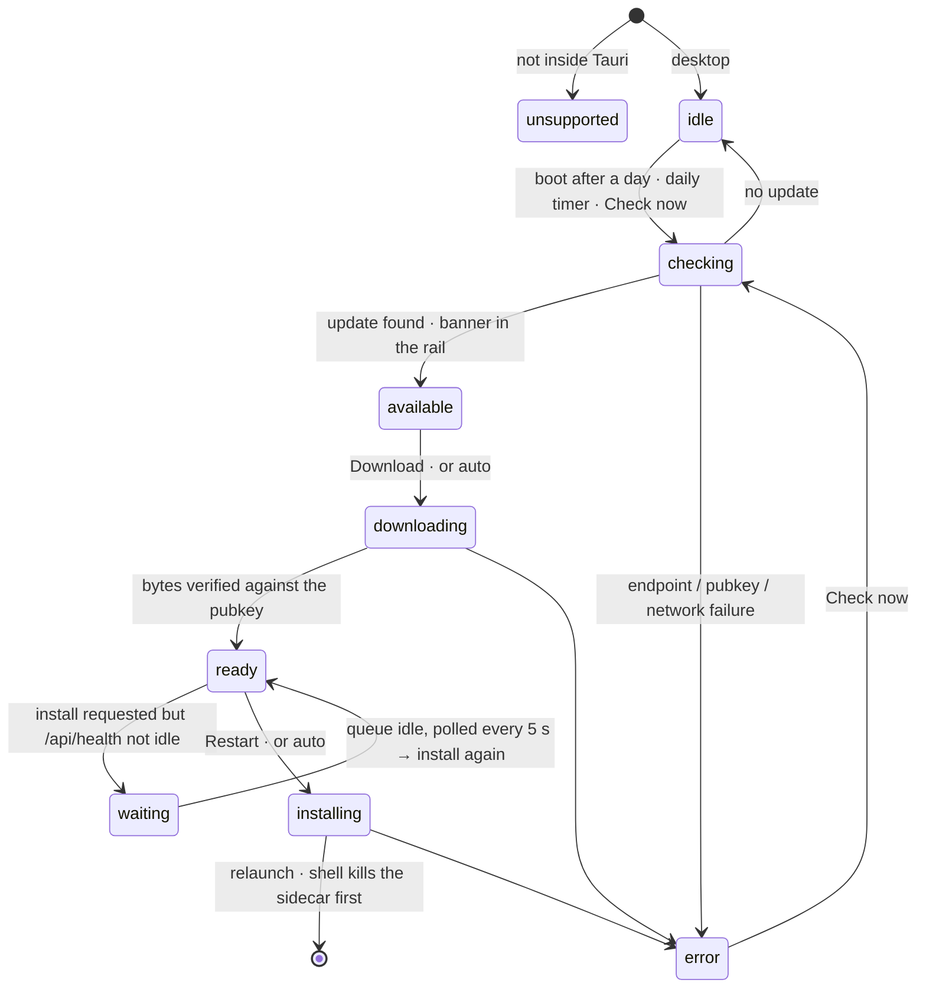

## h. Release pipeline

`scripts/bump-version.sh X.Y.Z` writes the version into `tauri.conf.json` (the
source of truth — `__VERSION__` in CI comes from it), `deliverer/package.json`,
`reaver/pyproject.toml`, `coreflame/__init__.py`, promotes `## Unreleased` in
`CHANGELOG.md` and refreshes the lockfile. `.github/workflows/release.yml`
runs on `v*` tags. Inside every build job the Python sidecar is built and
smoke-tested **before** `tauri-action`, because on a clean runner
`resources/sidecar/` is empty and locally it holds last week's daemon. The
release is created as a **draft**; `latest.json` 404s until it is published,
so nobody updates before the verification list in
`.claude/skills/cut-release/SKILL.md` is done.

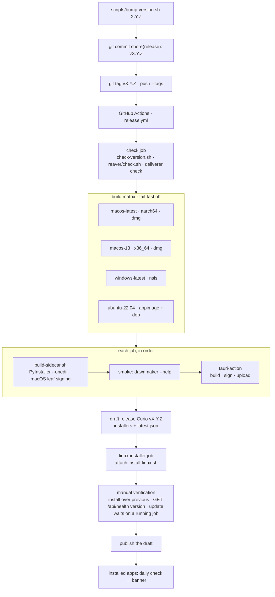

Secrets: `TAURI_SIGNING_PRIVATE_KEY` and `_PASSWORD` (the update channel's root
of trust; losing it strands every install), plus the optional `APPLE_*` set for
notarisation. `luissebastian953` and `REPLACE_WITH_PUBLIC_KEY` stay in the repo
until the one-time setup in the skill is done.

## i. Daemon request security

Loopback is reachable by every process on the machine and, through DNS
rebinding, by a browser tab on a malicious page. `dawnmaker/security.py`
answers with three cheap defences on top of the ephemeral port: a per-launch
bearer token handed over stdout; a `Host` check (only `127.0.0.1:<port>` and
`localhost:<port>`); and an `Origin` check that accepts the Tauri origins
(`tauri://`, `http(s)://tauri.localhost`) always and `http://localhost:*` /
`http://127.0.0.1:*` only with `--dev`. The webview is always a different
origin from the daemon, so every request is CORS: the middleware answers
preflights itself and reflects only an allowed origin, never `*`. Because
neither `EventSource` nor `` can set headers, `?token=` is accepted on
exactly `/api/events`, `/api/media/*` and `/api/preview/*` and ignored
everywhere else. Every request opens its own `Store`: the dependency and the
endpoint run on different threadpool threads, and the SSE stream pins one for
its whole lifetime, so a thread-local connection cache was wrong.

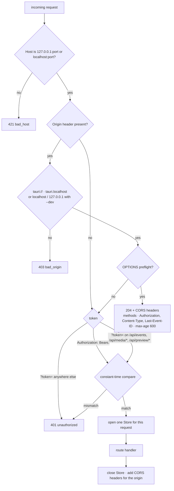

## j. Design system

`deliverer/src/styles.css` is the whole design system: Tailwind v4 is
CSS-first, so the `@theme` block *is* the config and every token is both a CSS
variable and a utility family. Colors are the sampled "cyber build" ladder —
cool hue-265 neutrals, magenta `ember` as the single accent, `cyan` reserved
for the cross-source link, `moss` ok, `rose` error; the Tailwind default
palette is removed on purpose. Spacing is a fixed px ladder (`p-15` = 15 px;
`p-4` does not exist). The type ramp is `xsmall small base medium extra ultra`
with line-heights baked in. Fonts: Chakra Petch for UI text, IBM Plex Mono for
numbers and keys, Noto Sans JP for Japanese. Radii are reset to square with
one `rounded-chip` (2 px). Custom utilities give the signature: `cut` (clip-path
corners), `scan` (scanline overlay), `data` (mono tabular readout),
`container`, `h-custom-screen`. Component classes (`.btn .panel .chip .phead
.ptitle .field .bar .rk-*`) are plain CSS in `@layer components` on the same
variables; Reka UI supplies behaviour (Dialog, Select, Slider, Switch,
Tooltip) and is skinned with the `.rk-*` classes.

At runtime `stores/theme.ts` re-hues the neutral ladder from one picked
background with `color-mix(in oklch, …)` — plates ~4 % above the canvas,
hairlines ~9 % — flips text for a light canvas, sets `--plate-opacity`,
`--plate-blur`, `--grid-alpha`, and toggles the `no-scan` and `corners-cut`
classes on `<html>`. It persists to localStorage only; the daemon never sees
theme state. `useTheme().apply()` runs in `App.vue` setup before first paint.
The i18n layer sits alongside: every string is a key in
`src/locales/<locale>/<namespace>.json`, English complete, others enabled per
locale with `ready: true`; `scripts/i18n-check.mjs` fails on a missing key or
leftover literal prose.

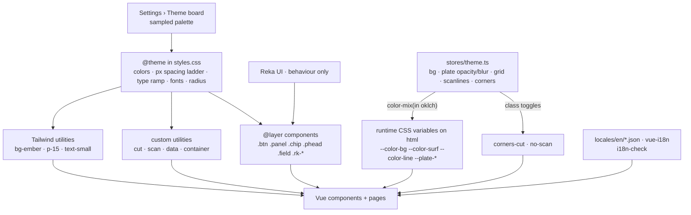

## k. Development workflow

A feature crosses every layer, bottom up, so the CLI keeps working while the
UI is mid-refactor: engine first with an offline test (fixture payloads, never
the network), then the daemon route and its test, then `lib/types.ts` (the
shapes must match `dawnmaker/app.py`), the Pinia store, the component with its
i18n keys and a Vitest that tests behaviour rather than markup, then docs,
skills and a `CHANGELOG.md` line. `pnpm check` at the root is the definition
of done. Commit with `pnpm commit`: husky runs lint-staged (Prettier + ESLint
on deliverer files, ruff on reaver files) on `pre-commit` and commitlint on
`commit-msg`; the scope list is fixed. A tag is what triggers CI. The skills
under `.claude/skills/` (`commit`, `cut-release`, `add-source-adapter`,
`diagnose-network`, `conventions-python`) are the written-down versions of
these steps.

```mermaid
flowchart LR
  skill["read the skill for the task<br/>.claude/skills/*"] --> eng["coreflame change<br/>+ offline test with fixture"]
  eng --> route["dawnmaker route<br/>+ test"]
  route --> types["lib/types.ts<br/>in step with app.py"]
  types --> store["Pinia store"]
  store --> comp["component + i18n keys<br/>+ Vitest behaviour test"]
  comp --> docs["docs · skills · CHANGELOG Unreleased"]
  docs --> check["pnpm check<br/>vue-tsc · eslint · prettier · i18n-check · vitest<br/>reaver/check.sh · check-version.sh"]
  check --> commit["pnpm commit<br/>husky: lint-staged → commitlint"]
  commit --> tag["scripts/bump-version.sh · tag"]
  tag --> ci["release.yml"]
```

## l. Data layout

Two roots, deliberately apart. The **library folder** (Settings › Storage;
`Config.blob_root` is `<library>/blobs`) holds only derived-from-the-web bytes:
`blobs/` is content-addressed (`aa/bb/<sha256>.<ext>`), `thumbs/` mirrors it
with 400 px WebP made at ingest, and `by-character/<slug>/` is the
human-browsable view — hardlinks, so a second name costs no bytes and survives
a copy, unlike symlinks (`coreflame/library.py`; the view is derived and safe
to delete). **`~/.reaver/`** (`REAVER_HOME` overrides it; `/data` in Docker)
holds everything that must not live on a synced or network drive: the SQLite
database with its WAL, the config, the secrets (0600), the gallery-dl cookie
file and the daemon lockfile. Raw fetched payloads are stored zlib-compressed
inside the database, keyed by hash, so re-normalisation never re-fetches.
Moving the library moves only images; `PUT /api/config` refuses a library path
under a Dropbox/OneDrive/Google Drive/iCloud folder because sync clients
materialise hardlinks as copies.

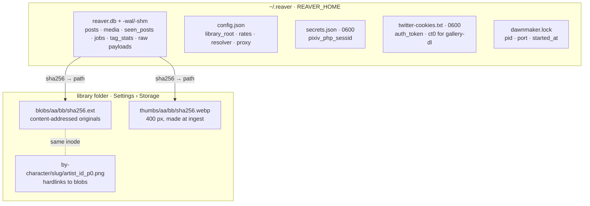
