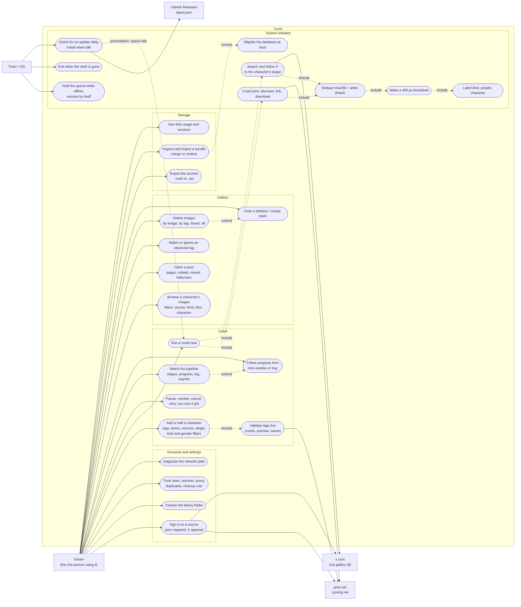

# 1. Use case diagram

One human actor, two external systems the crawler talks to *as that human*,
and a handful of things the system does on its own clock. Mermaid has no
use-case shape, so: rectangles are actors, stadiums are use cases, the
`Curio` subgraph is the system boundary, and `include` / `extend` are written
on the edges.

Sources: `deliverer/src/pages/*.vue` (what the user can click),
`reaver/dawnmaker/app.py` (what the daemon offers), `reaver/coreflame/cli.py`
(the same engine from a terminal), `reaver/coreflame/jobs.py` and
`reaver/dawnmaker/__main__.py` (what runs unprompted).

## Actors

| Actor | Role | Notes |
|---|---|---|
| Owner | the single user; configures, runs, browses, deletes, backs up | There is no second role. The CLI (`coreflame ...`) is the same actor through another door; it shares the database and the job table, so a cancel from the terminal is honoured by the daemon. |
| pixiv.net | discovery source: tag search and artwork detail over the ajax endpoints; `i.pximg.net` serves the bytes and needs `Referer` (**LB**) | Curio acts with the owner's own session cookie, verified once before it is stored. |
| x.com | follow source: artists' timelines and a careful, target-driven search, only through `gallery-dl` as a subprocess (**LB**) | Optional. No character metadata exists there, so X never discovers; it follows what pixiv found. |
| GitHub Releases | the update channel: a signed `latest.json` and the installers | Read-only from the app's side. |
| Timer / OS | the heartbeat clock, the daily update check, the online probe, the 30-day trash sweep | What makes the "system-initiated" cases fire. |

## Use cases that carry a rule

- **Run a crawl** always plans per source: one pixiv job and one X job per
  character plus one X `timelines` sweep (`handlers.plan`). An unticked
  source is never requested.
- **Install an update** has a precondition: the job queue is idle. With a
  worker busy the updater waits and says so (architecture §8b.3).
- **Import a bundle** refuses unless the queue is paused and empty
  (409 `busy`), because it merges in one transaction over the live tables.
- **Delete images** goes to a trash folder first; permanent deletion is a
  separate, held confirmation and is refused above 500 images or 1 GB.
- **Sign in** never shows Curio a password: the site's own page opens in a
  window with no IPC, and only the session cookie travels to the daemon.
