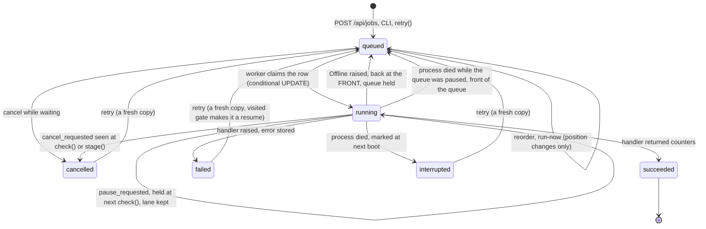
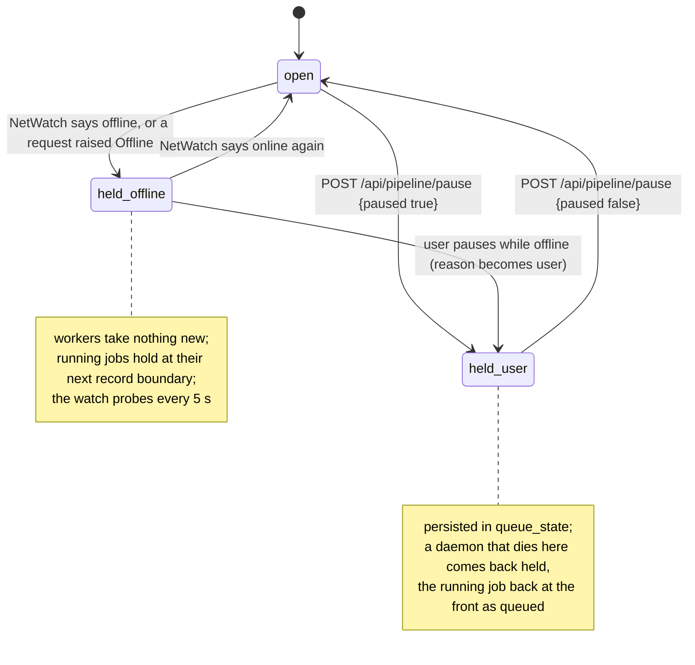
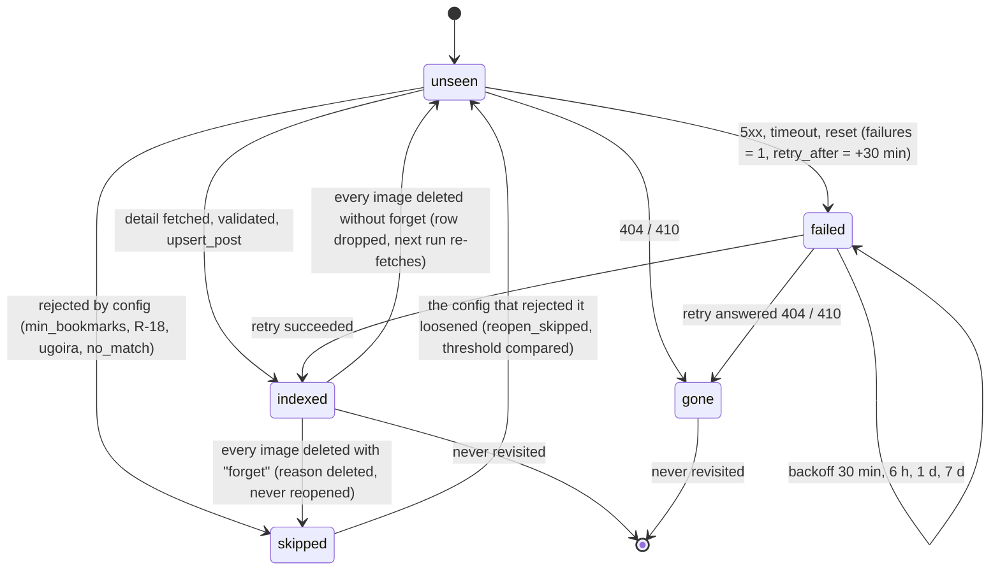
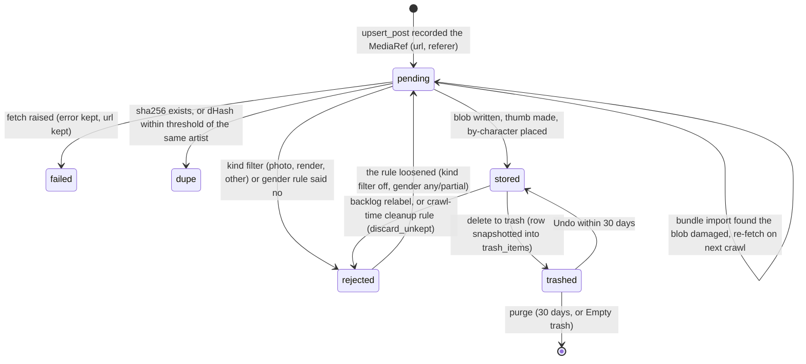
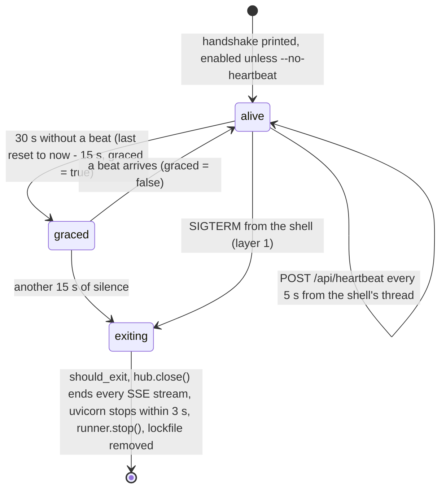
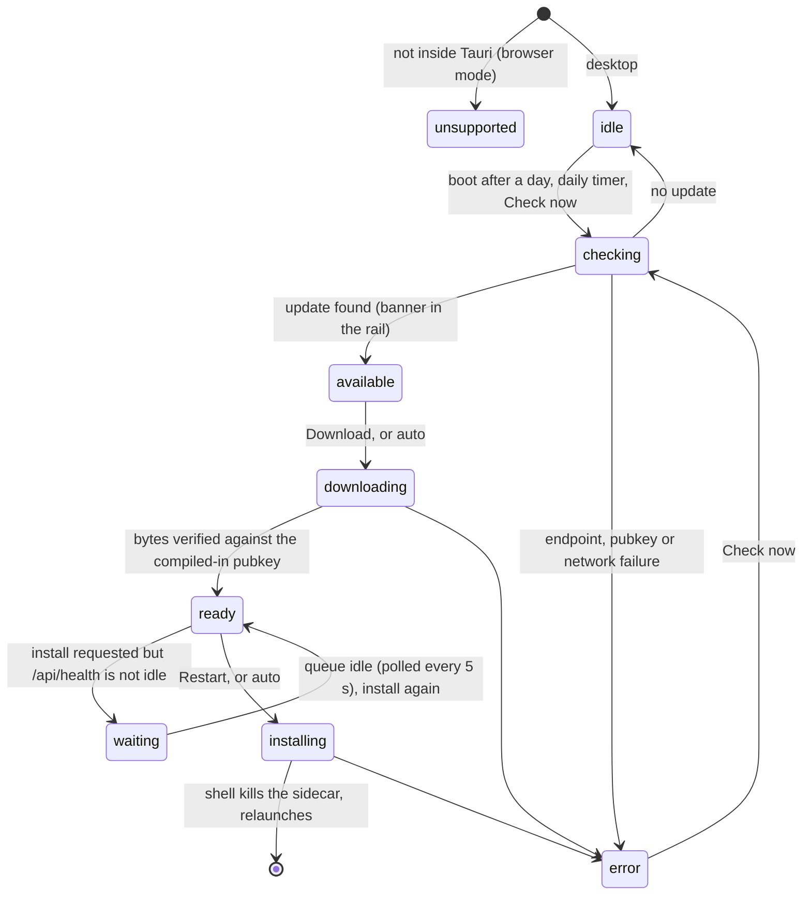
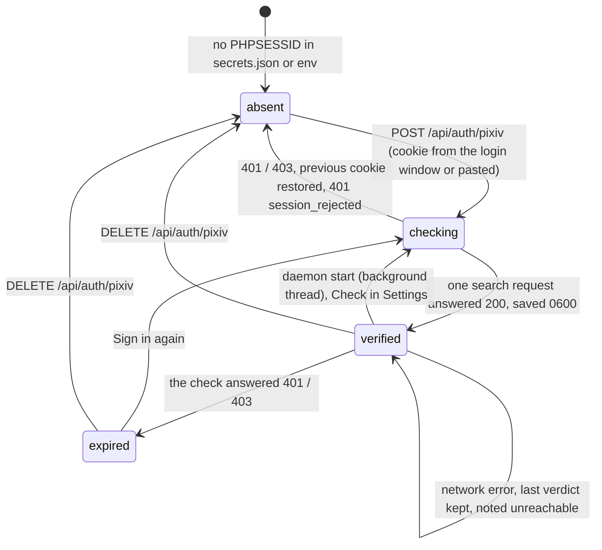

# 2. State machine diagrams

The states that carry policy. Each one is a column in SQLite or a field in a
store, so a restart reads the machine back exactly where it was. Collapsing
any of the first two is the bug the root `CLAUDE.md` warns about (**LB**).

## 2.1 Job (`coreflame/jobs.py`, table `jobs`)

Six states. One worker thread per lane (`pixiv`, `twitter`) claims the first
`queued` row of its lane, or an `any` job, with a conditional `UPDATE`.
Cancel and pause are columns (`cancel_requested`, `pause_requested`) read at
`ctx.check()` between records, never inside a write, so another process can
set them too.

Invariants: a `running` row at boot means the process died (`mark_interrupted`);
a cancel can only land between complete records because `upsert_post` is one
transaction; `total` is `NULL` when no honest denominator exists.

## 2.2 The queue hold (`JobRunner.hold`, table `queue_state`)

The queue as a whole has its own two-valued state with a *reason*. A user's
pause outranks the connection's: pausing by hand while offline makes the hold
the user's, and only the user lifts it.

## 2.3 A visited post (`coreflame/seen.py`, table `seen_posts`) **LB**

Four states, four retry policies. Consulted from the search listing, where
the id is free, *before* a detail request is spent. `posts` is not the gate;
it only holds what was kept.

`should_fetch` is true only for `unseen` and for `failed` past its
`retry_after`. The `threshold` column stores the config value that caused a
skip, so lowering `min_bookmarks` reopens exactly the rows it would now admit.

## 2.4 A media row (`pipeline.download_pending`, table `media`)

One row per image of a post (`idx`). The crawl records the row at discover
time; the download stage moves it.

`dupe_of` names the stored sha a dupe resolves to; the gallery shows a dupe
row's bytes through its original. `trashed` is not a `state` value but a move
of the row into `trash_items`; it is drawn here because Undo brings the same
row back.

## 2.5 Heartbeat watchdog (`dawnmaker/app.py Heartbeat`, `__main__.watchdog`)

Layer 2 of the sidecar lifecycle. A gap is as often a sleeping laptop as a
dead shell, so the first silence is graced once.

## 2.6 Updater (`deliverer/src/stores/updater.ts`)

## 2.7 A pixiv session (`dawnmaker/auth.py`, `stores/sources.ts`)

`poll_pixiv` refuses to start in any state but `verified`, rather than
401-ing once per tag. X cookies have only `absent` and `stored`: they cannot
be verified without a timeline fetch.
