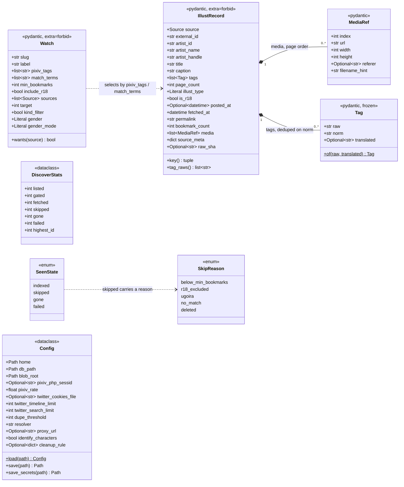
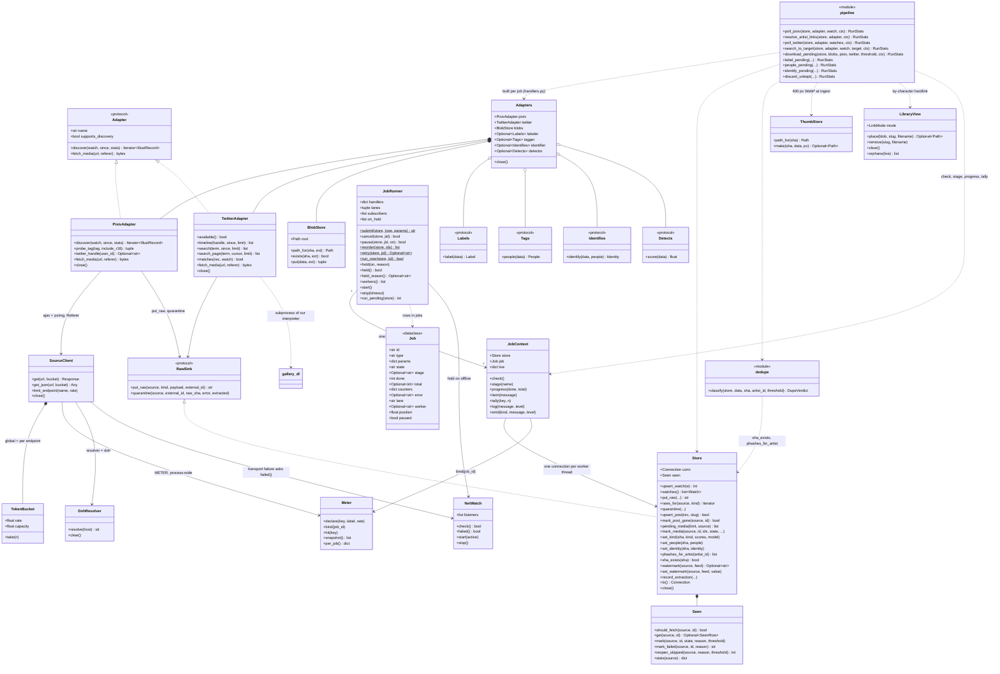
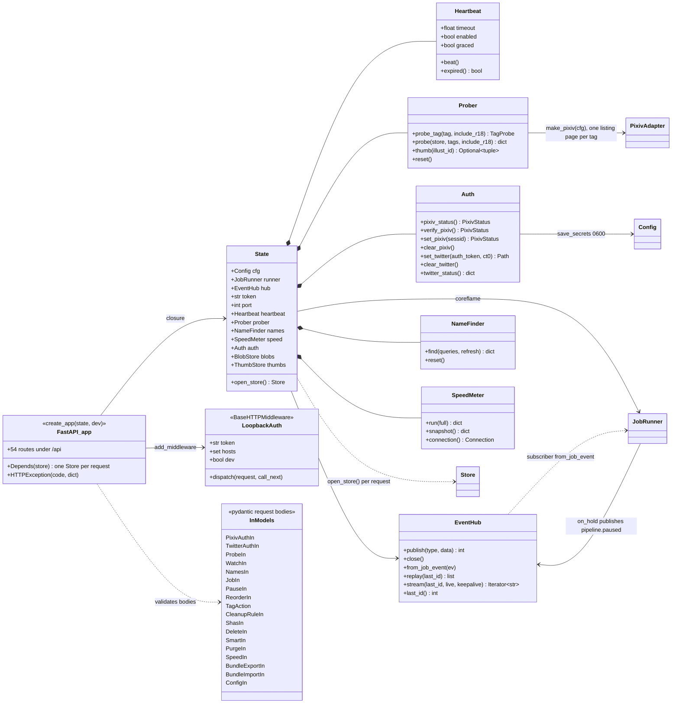
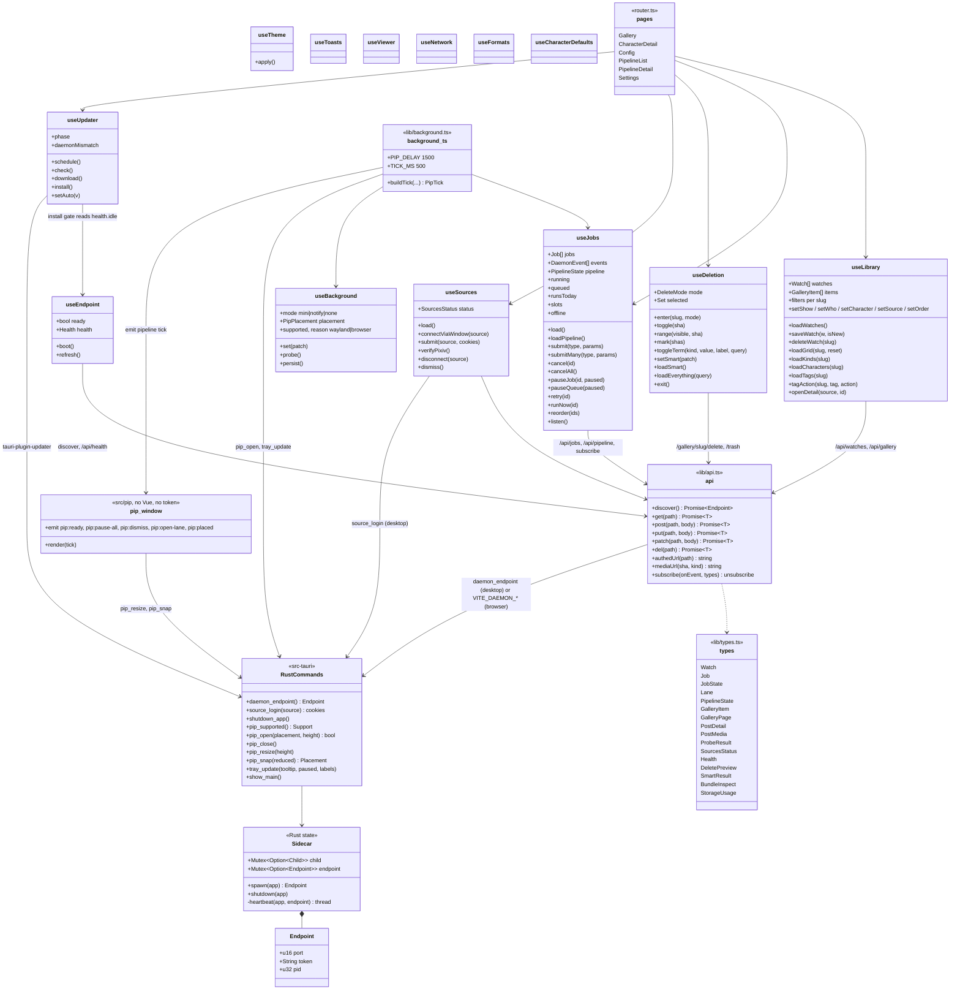

# 3. Class diagrams

Four diagrams, one per layer, in dependency order: the engine's domain, the
engine's runtime, the daemon, the webview. Arrows only ever point *down* this
page: `dawnmaker` imports `coreflame`, `coreflame` never imports `dawnmaker`,
and `deliverer` knows neither beyond the HTTP contract (**LB**).

Type notation follows the code: Python annotations in the first three,
TypeScript in the last. `Optional~T~` stands for `T | None`.

## 3.1 Domain model (`coreflame/models.py`, `seen.py`, `config.py`)

The normalization boundary. Every adapter builds an `IllustRecord` once, at
its edge, with media in hand; nothing downstream sees a source-shaped dict.

Rules carried by validators: ids are `str` (snowflakes exceed JS safe
integers), datetimes are tz-aware UTC, `page_count` is reconciled with
`len(media)`, tags are deduped on `norm` (NFKC + casefold) while `raw` is kept
for pixiv's exact search.

## 3.2 Engine runtime (`coreflame/`)

`handlers.build_handlers` maps a job type (`poll`, `timelines`, `link`,
`media`, `tags`, `label`, `export`) to a function `(JobContext) -> counters`;
`handlers.plan` splits one `poll` request into per-source jobs. The classifier
protocols (`Labels`, `Tags`, `Identifies`, `Detects`) have ONNX implementations
behind the optional `classify` extra and are `None` when numpy/onnxruntime are
absent, so the engine stays importable without them (`Detects` is the AI-or-hand
detector of `origin.py`; pixiv's flag and AI hashtags are read without it).

## 3.3 Daemon (`dawnmaker/`)

## 3.4 Webview and shell (`deliverer/`)

Pinia option stores call `lib/api.ts`; `lib/types.ts` mirrors
`dawnmaker/app.py` and is the only contract the webview has. The Rust side is
a handful of commands the webview `invoke`s.

The mini window has no token and never fetches: everything it shows arrives
in a `PipTick` from the main window, and every click comes back as a `pip:*`
event (`src/pip/protocol.ts`).
