# 4. Object diagram

One character at one moment, as the rows actually look. Mermaid has no object
diagram, so the class syntax is used with `instance : Class` labels and
`attribute = value` members. Values are illustrative; the shapes are the
tables in `coreflame/migrations.py` and the models in `coreflame/models.py`.

The scene: the owner watches **Ganyu**. A pixiv crawl indexed artwork
`123456789` by artist `1234567` (two pages). The link stage found that
artist's X handle; the X worker then found the same picture reposted as a
JPEG on X, and the artist-scoped dHash marked it a duplicate of the pixiv
PNG. One older artwork was skipped for having too few bookmarks, one was
deleted upstream.

```mermaid
classDiagram
  direction LR

  class ganyu["ganyu : Watch"] {
    slug = ganyu
    label = Ganyu
    pixiv_tags = 甘雨, Ganyu
    match_terms = 甘雨, Ganyu
    min_bookmarks = 50
    include_r18 = false
    sources = pixiv, twitter
    target = 100
    kind_filter = true
    gender = female
    gender_mode = full
  }

  class artist["pixiv/1234567 : artists"] {
    source = pixiv
    artist_id = 1234567
    name = foo
    twitter_handle = foo_art
    followed = 1
    checked_at = 2026-10-20T08:00:00Z
  }

  class post1["pixiv/123456789 : posts"] {
    source = pixiv
    external_id = 123456789
    artist_id = 1234567
    title = 甘雨
    page_count = 2
    illust_type = illust
    is_r18 = 0
    posted_at = 2026-10-19T12:00:00Z
    bookmark_count = 812
    permalink = https://www.pixiv.net/artworks/123456789
    raw_sha = 7c1e…
    state = live
  }

  class pw1["post_watches"] {
    source = pixiv
    external_id = 123456789
    slug = ganyu
  }

  class tag1["post_tags"] {
    tag_raw = 甘雨
    tag_norm = 甘雨
  }
  class tag2["post_tags"] {
    tag_raw = 原神
    tag_norm = 原神
    translated = Genshin Impact
  }

  class m0["pixiv/123456789/0 : media"] {
    idx = 0
    url = https://i.pximg.net/img-original/…_p0.png
    sha256 = a1f3…
    phash = -3812…
    bytes = 7340032
    width = 2894
    height = 4093
    ext = png
    state = stored
    source_variant = original
  }
  class m1["pixiv/123456789/1 : media"] {
    idx = 1
    sha256 = b2c4…
    ext = png
    state = stored
    source_variant = original
  }

  class post2["twitter/1890000000000000000 : posts"] {
    source = twitter
    external_id = 1890000000000000000
    artist_id = 987654
    artist_handle = foo_art
    posted_at = 2026-10-19T13:30:00Z
    permalink = https://x.com/foo_art/status/1890000000000000000
    state = live
  }
  class m2["twitter/1890000000000000000/0 : media"] {
    idx = 0
    url = https://pbs.twimg.com/media/….jpg:orig
    sha256 = 9e77…
    phash = -3810…
    state = dupe
    dupe_of = a1f3…
    source_variant = orig
  }

  class s1["pixiv/123456789 : seen_posts"] {
    state = indexed
    first_seen = 2026-10-20T08:01:12Z
  }
  class s2["pixiv/123456700 : seen_posts"] {
    state = skipped
    reason = below_min_bookmarks
    threshold = 50
  }
  class s3["pixiv/123456600 : seen_posts"] {
    state = gone
  }
  class s4["twitter/1890000000000000000 : seen_posts"] {
    state = indexed
  }

  class wm1["pixiv / tag:甘雨 : poll_state"] {
    watermark = 123456789
  }
  class wm2["twitter / search:甘雨 : poll_state"] {
    watermark = 1890000000000000000
  }

  class k0["a1f3… : image_kinds"] {
    kind = illustration
    model = …
  }
  class p0["a1f3… : image_people"] {
    girls = 1
    boys = 0
    male_focus = 0
  }
  class i0["a1f3… : image_identity"] {
    state = identified
  }
  class ic0["a1f3… / ganyu : image_characters"] {
    name = ganyu
    tag = ganyu_(genshin_impact)
    score = 0.93
    by = both
  }

  class blob0["blobs/a1/f3/a1f3….png : file"] {
    bytes = 7340032
  }
  class thumb0["thumbs/a1/f3/a1f3….webp : file"] {
    px = 400
  }
  class byc0["by-character/ganyu/foo_123456789_p0.png : file"] {
    same inode as blob0
  }

  class job1["job 6f2a… : jobs"] {
    type = poll
    params = watches ganyu, source pixiv
    state = succeeded
    lane = pixiv
    worker = pixiv
    counters = listed 240, gated 231, fetched 9, new 9, stored 17, dupes 0
  }
  class job2["job 6f2b… : jobs"] {
    type = poll
    params = watches ganyu, source twitter, target 100
    state = succeeded
    lane = twitter
    counters = posts 100, dupes 12
  }

  ganyu --> pw1 : slug
  pw1 --> post1
  post1 --> artist : artist_id
  post1 *-- m0
  post1 *-- m1
  post1 *-- tag1
  post1 *-- tag2
  post1 ..> s1 : same key
  post2 *-- m2
  post2 ..> s4 : same key
  artist ..> post2 : twitter_handle = artist_handle
  m2 --> m0 : dupe_of, phash d=2 within one artist
  m0 --> blob0 : sha256
  m0 --> thumb0 : sha256
  blob0 .. byc0 : hardlink
  m0 ..> k0 : sha256
  m0 ..> p0 : sha256
  m0 ..> i0 : sha256
  i0 *-- ic0
  ganyu ..> wm1 : feed per pixiv tag
  ganyu ..> wm2 : feed per match term
  job1 ..> post1 : indexed
  job2 ..> post2 : kept
  s2 ..> ganyu : reopens if min_bookmarks drops below 50
```

What the picture shows that the schema alone does not:

- **A post is not an image.** `post1` has two `media` rows; the gallery counts
  images, the visited set counts posts.
- **The gate is `seen_posts`, not `posts`.** `s2` and `s3` have no `posts`
  row at all, yet the next crawl spends no request on them. `s2` remembers
  the threshold that rejected it.
- **Dedupe is a pointer, not a deletion.** `m2` stays as a row with
  `dupe_of`, so the X post still appears in the detail aside as a "linked"
  post and its bytes are `m0`'s.
- **Three names, one file.** `blob0` and `byc0` are the same inode; the
  thumbnail is a second, smaller file addressed by the same sha.
- **Classifier rows hang off the sha, not the post.** A repost shares the
  label; a new model is a re-label, never a re-fetch.
- **Two jobs for one "Run".** `handlers.plan` made a pixiv job and an X job;
  each ran on its own lane.
