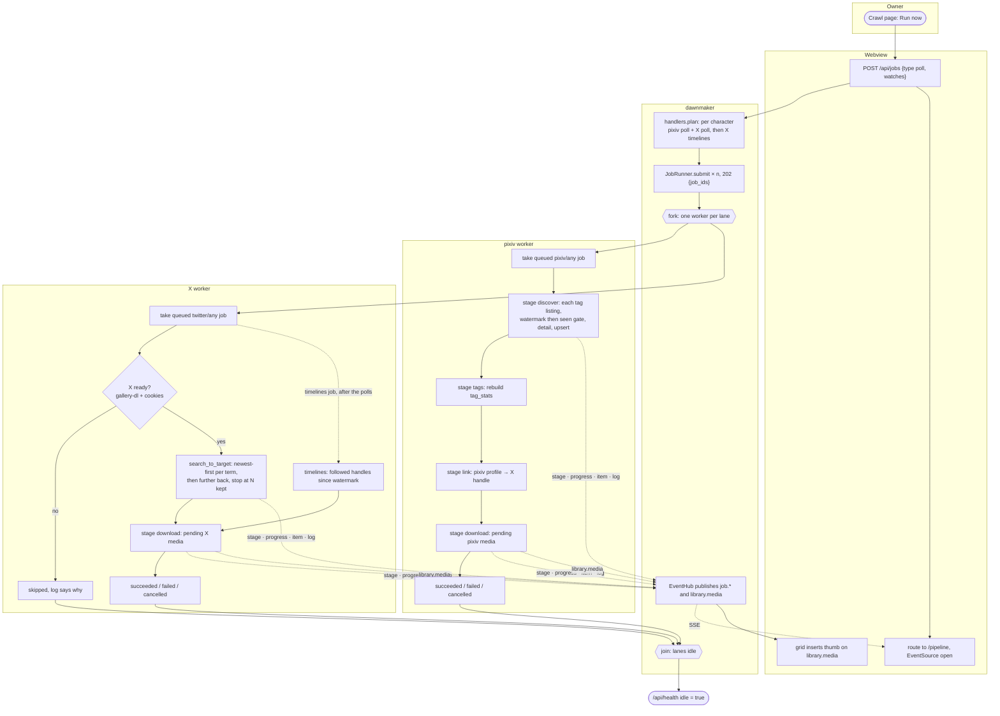
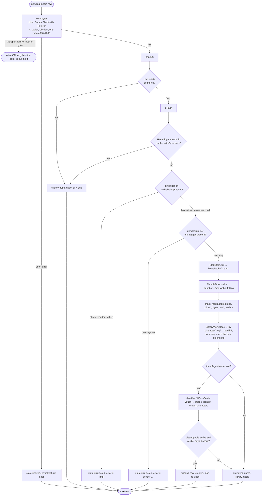
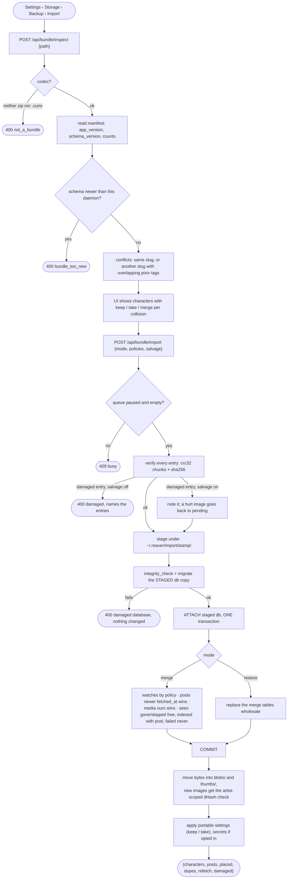

# 5. Activity diagrams

Swimlanes are `subgraph`s; diamonds are decisions; the thick bars are
forks and joins. The full crawl pipeline with every gate is drawn in
[`../flows.md`](../flows.md) §c; here the view is the *activity* across
actors, plus two activities flows.md does not have.

## 5.1 Run a crawl

From the owner's click to a thumbnail in the grid. The two lanes run in
parallel because they hit different hosts; a job never crosses lanes.

Between any two records a worker calls `ctx.check()`: that is where a
cancel, a pause (hold in place, lane kept) or an `Offline` (job back at the
front, queue held) lands. Never inside a write.

## 5.2 Ingest one image (`pipeline.download_pending`)

The activity behind every `pending` media row. Order matters: the cheap
checks come first, the classifier (if installed) only runs on bytes that
would otherwise be kept, and nothing is written to the library before the
dedupe verdict.

A `rejected` row keeps its url. Loosening the rule that rejected it
(`Store.upsert_watch` compares old and new) puts it back to `pending`, and
the next download judges it again.

## 5.3 Import a bundle (`bundle.import_`, `POST /api/bundle/import`)

Verification gates before anything touches the live archive; one
transaction for the merge; bytes move only after the commit.

