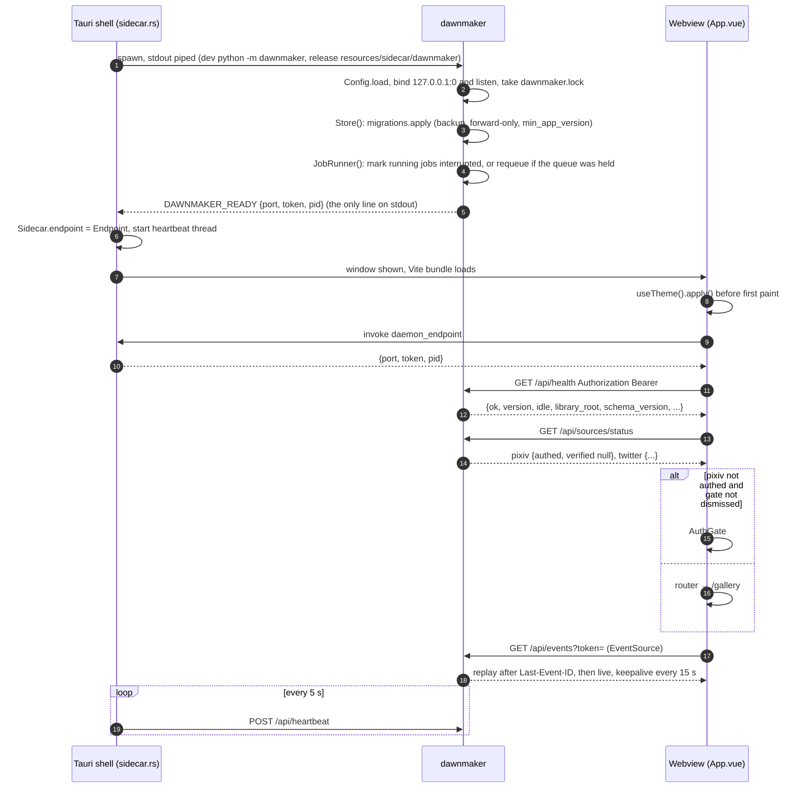
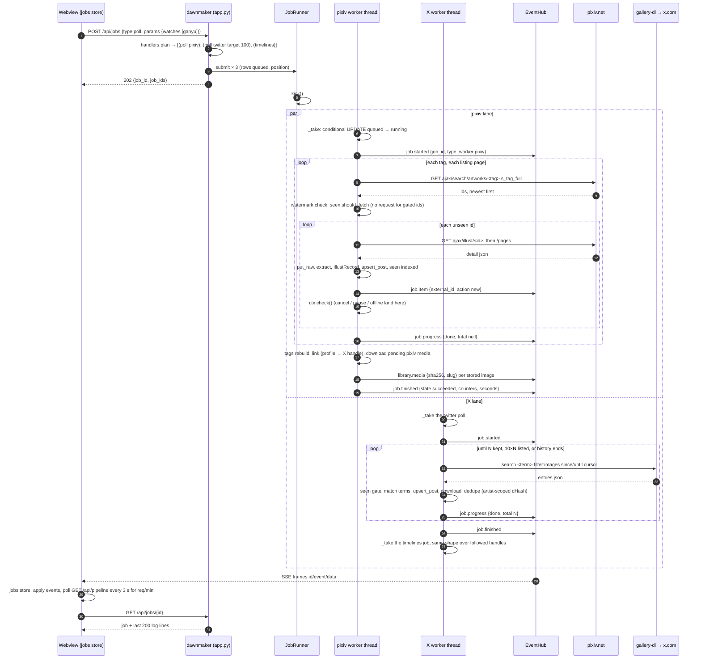
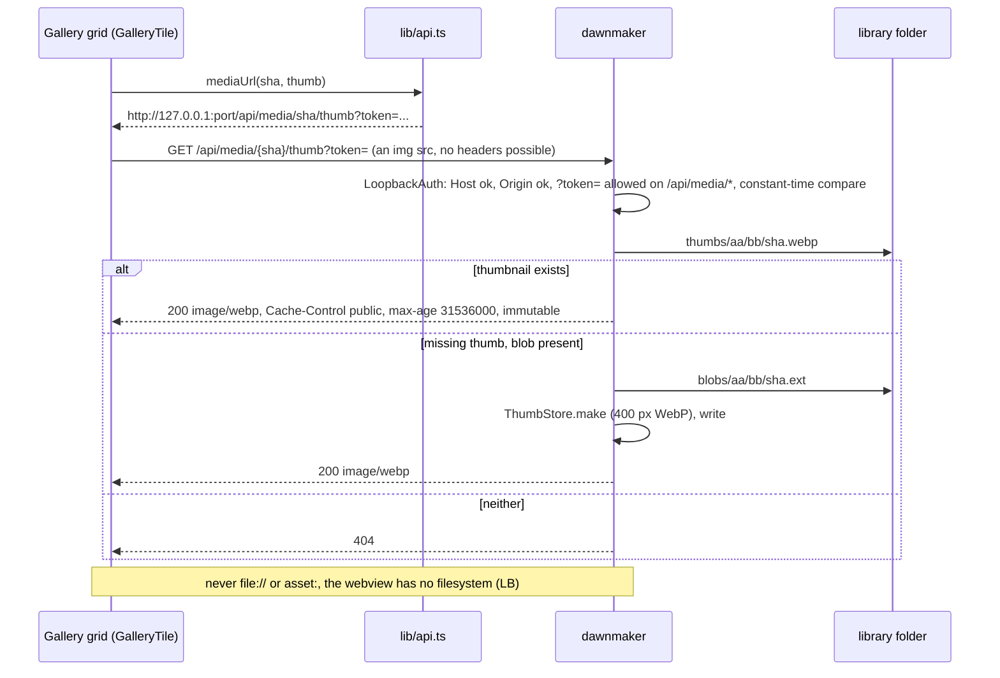
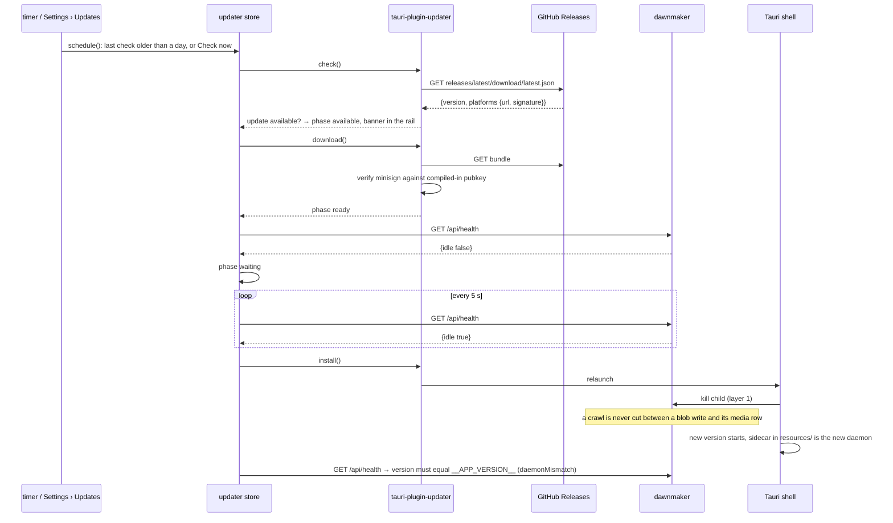
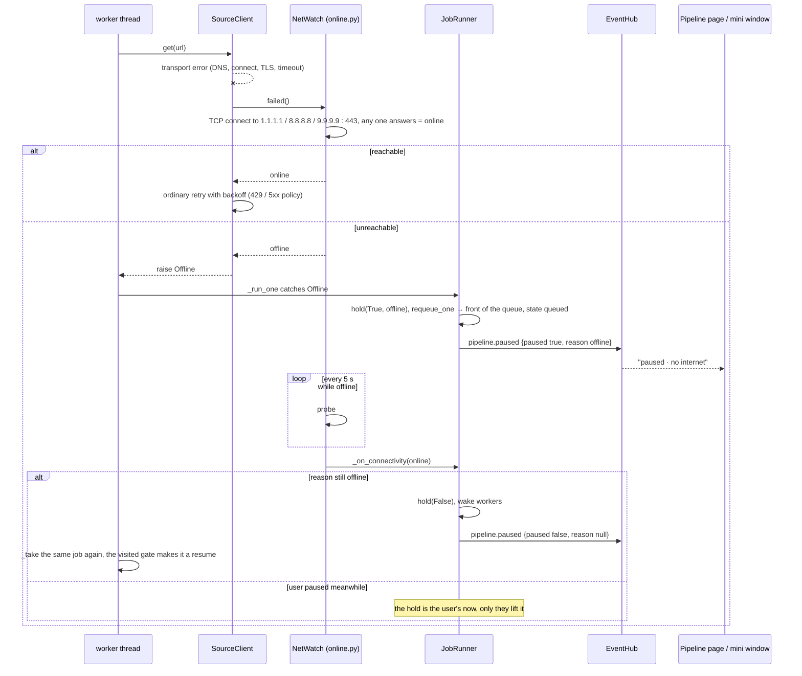
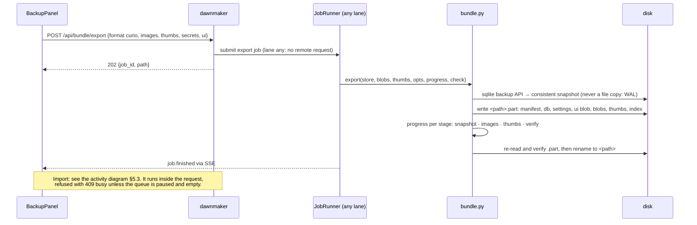

# 6. Sequence diagrams

Messages between the four parties that exist at runtime: the Tauri shell
(Rust), the webview (Vue), the daemon (`dawnmaker` over `coreflame`) and the
sites. Six flows live in [`../flows.md`](../flows.md) already and are not
repeated: process lifecycle (§b), sign-in (§e), the character-form probe
(§f), deleting images (§m), the mini window (§n), and the daemon's request
security as a decision chart (§i). The six here fill the gaps.

## 6.1 Boot: handshake, token, first paint

The token never touches a file or argv; the stdout pipe is private to the
parent. The webview is a different origin from the daemon, so every call is
CORS and the daemon reflects only an allowed origin.

## 6.2 A crawl, as the Pipeline page sees it

## 6.3 A thumbnail reaches the grid

## 6.4 Update install, gated on an idle queue

## 6.5 The internet goes away mid-crawl, and comes back

## 6.6 Backup: export as a job, import as a request

