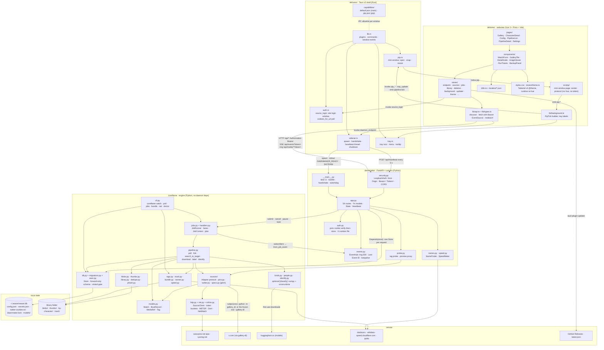

# 7. Component diagram

Three processes on one machine plus the sites they reach. Each box is a
component with the interface it *provides* written on the edge that leads to
it. The one rule the picture must keep: dependencies point from `deliverer`
to `dawnmaker` to `coreflame`, never back (**LB**). That is what lets the
CLI drive the engine while the UI is mid-refactor.

## Provided and required interfaces

| Interface | Provider | Consumers | Shape |
|---|---|---|---|
| `DAWNMAKER_READY` line | `dawnmaker/__main__.py` | `sidecar.rs`, `docker/entrypoint.sh` | one JSON line on stdout: `{port, token, pid}`; everything else logs to stderr |
| REST `/api/*` | `dawnmaker/app.py` behind `LoopbackAuth` | `lib/api.ts`, the heartbeat thread, `curl` in dev | JSON; `Authorization: Bearer`; errors `{"error": {code, message}}`; contract in architecture §6 |
| SSE `/api/events` | `EventHub` | `lib/api.ts subscribe` | `id/event/data` frames, `Last-Event-ID` replay from a 500-event ring, keepalive comments |
| Image routes `/api/media/*`, `/api/preview/*` | `app.py` | `` in the grid and the form | `?token=` allowed here only; thumbs immutable-cached |
| Tauri commands | `src-tauri/src/*.rs` | stores, `background.ts`, `src/pip` | `invoke(name, args)`; allowlisted per window by `capabilities/*.json`; the `source-login` window has none |
| Window events | main webview and `pip` window | each other | `pipeline:tick` down, `pip:*` up; `tray:*` from Rust |
| `Adapter` protocol | `sources/base.py` | `pipeline.py`, `probe.py` | `discover(watch, since, stats)`, `fetch_media(url, referer)`; records are `IllustRecord` at the edge |
| `Handler` | `handlers.build_handlers` | `JobRunner` | `(JobContext) -> counters`, keyed by job type |
| `Labels` / `Tags` / `Identifies` | `kinds.py` / `people.py` / `identify.py` | `pipeline.py` | `None` when the `classify` extra is missing; the engine must import without it |
| SQLite file | `Store` over `migrations.py` | daemon threads (one connection each), the CLI | WAL; natural-key upserts; `jobs.cancel_requested` is the cross-process cancel |
| gallery-dl | the `gallery_dl` module run as a subprocess | `TwitterAdapter` | JSON output; cookies file and proxy passed through; owns the X protocol layer |

## What is deliberately not a component

- No background service, agent or server: the daemon lives exactly as long
  as the shell beats (Docker's `--no-heartbeat` is the dev exception).
- No image proxy: `/api/preview/*` serves only ids a probe returned.
- No second update channel: the sidecar is a bundle *resource*, so the shell
  and the daemon are one artifact and cannot skew.
