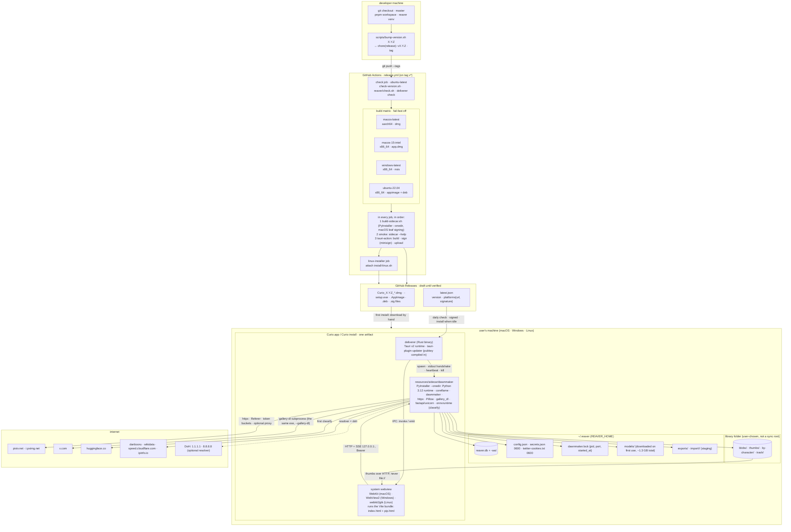
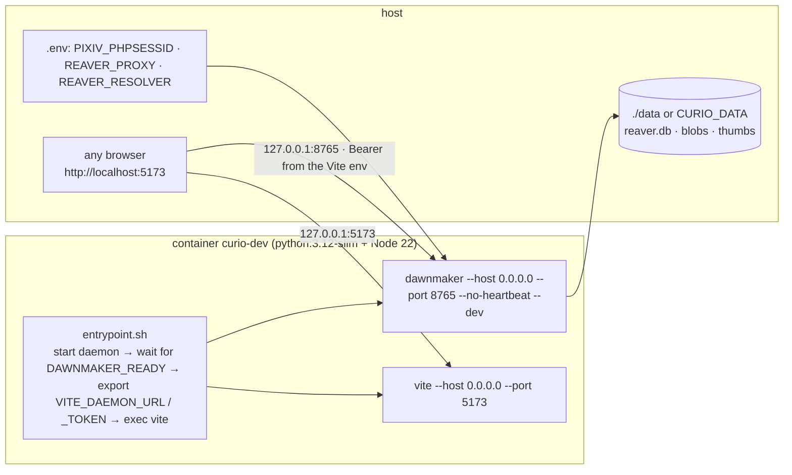
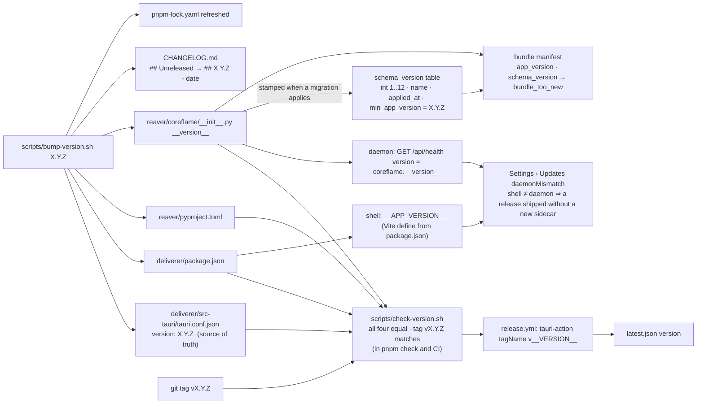

# 8. Deployment diagram, and how a version travels

Two deployment shapes exist: the **desktop app** (the product) and the
**browser-mode stack** (Docker, for development without Rust). Both run the
same daemon and the same Vue bundle; only the shell differs.

## 8.1 Desktop deployment

Execution environments, by node:

| Node | Runtime | Process boundary | Notes |
|---|---|---|---|
| `deliverer` | Rust, Tauri v2 | the app process | owns the window, tray, login window, mini window, updater, and the daemon's lifetime |
| webview | the OS webview | same process, separate origin (`tauri://localhost` or `http://tauri.localhost`) | no filesystem, no cookies for the sites; CSP allows `http://127.0.0.1:*` for `connect-src` and `img-src` only |
| `dawnmaker` | frozen CPython 3.12 (PyInstaller) in release; the venv's `python -m dawnmaker` in a debug build | child process | one per machine, enforced by the lockfile; exits ~30 s after the shell's beats stop (graced once) |
| gallery-dl | the same frozen executable re-entered with `--gallery-dl`, or `python -m gallery_dl` | grandchild process per X request | so a user needs nothing on `PATH` |
| classifier models | ONNX, run in-process by onnxruntime | inside the worker thread | optional; absent in a build without the `classify` extra |

## 8.2 Browser-mode deployment (Docker)

Three things do not exist here: the sign-in window (paste the cookie), the
updater (the store is born `unsupported`), and the mini window / tray
(`pip_supported` answers `browser`). Compose publishes both ports on
`127.0.0.1` only; `0.0.0.0` inside the container is allowed only with
`--dev`.

## 8.3 Versioning: one number, five places, one gate

What is versioned, how, and what reads it:

| Thing | Scheme | Written by | Read by | Skew guard |
|---|---|---|---|---|
| The app (shell + webview + sidecar) | semver `X.Y.Z`, one number for the whole bundle | `bump-version.sh` into four files | the updater (`latest.json` vs installed), Settings › Storage header, `/api/health` | `check-version.sh` fails `pnpm check` and CI on drift; `tauri-action` substitutes `__VERSION__` from `tauri.conf.json` so tag, release name and manifest cannot disagree |
| Git history | one repo, `master`, Conventional Commits with a fixed scope list, annotated tags `vX.Y.Z` | `pnpm commit` (cz-git), commitlint on `commit-msg` | `release.yml` triggers on `v*` | the tag must equal the version in the files (`check-version.sh` under `GITHUB_REF_NAME`) |
| Database schema | integer, forward-only (`@migration(n, name)`), currently 12 | `migrations.apply` at `Store()` open, inside one transaction per step, after backing the file up | every `Store`, `/api/health`, `/api/storage` | `min_app_version` stamped with the app version that applied it: an older daemon refuses the db instead of half-reading it |
| API contract | unversioned on purpose | `dawnmaker/app.py`, mirrored by hand in `lib/types.ts` | the webview | shell and daemon ship as one artifact (`bundle.resources`), so there is never a version to negotiate; `daemonMismatch` catches a build that broke that promise |
| Backup bundle | manifest carries `app_version` and `schema_version`; two codecs (`.curio`, `.zip`) | `bundle.export` | `bundle.inspect` | `bundle_too_new` when the schema is newer than the importing daemon; the staged db is migrated forward on the copy before merging |
| Classifier verdicts | the model id stored on each `image_kinds` / `image_people` / `image_identity` row | the labeler on ingest | backlog passes (`unlabeled_media(model)`) | a new model is a re-label of stored bytes, never a re-fetch |
| Raw payloads | content-addressed (`raw_payloads.sha256`), `kind` names the spec | adapters via `put_raw` | `raws_for(source, kind)` | a spec fix is a re-parse of retained JSON |
| User-facing changes | `CHANGELOG.md`, newest first, `Added / Changed / Fixed / Removed` | every feature commit under `## Unreleased` | Settings › Updates renders it | `bump-version.sh` promotes the section with the date |
| Dependencies | `pnpm-lock.yaml` (frozen in CI), `pyproject.toml` ranges with `gallery-dl` kept current | `pnpm install`, `pip` | the Docker image, CI | `--frozen-lockfile` everywhere; gallery-dl owns the X protocol so updating it is the fix for an X breakage |

Release procedure and the post-release verification list (install over the
previous version, check the *daemon's* version, confirm `latest.json`
resolves, confirm an update waits on a running job): `.claude/skills/cut-release`.
